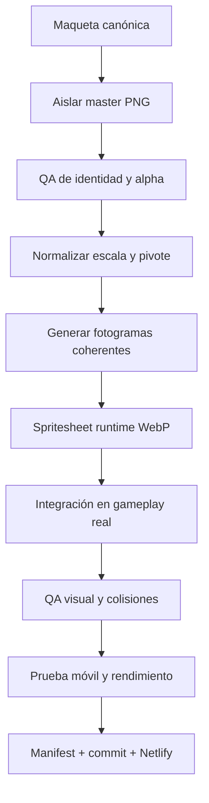

# NEON CRONIUM — MAPA DE PRODUCCIÓN DE 150 ASSETS

Versión de trabajo: **7.2.0**  
Catálogo vinculante: `ASSET_PRODUCTION_150.json`  
Referencia vigente: [mandato rector 10 capítulos × 10 etapas](docs/PRODUCT_VISION.md). Este catálogo conserva los 150 identificadores históricos para reutilización y trazabilidad; no define por sí solo el alcance de la campaña nueva. La demo Chronos-Gaia está en revisión, sin multiplicar todavía sus recursos por cien etapas.

Actualización17/10/2026: `chronos-debris-large` cuenta con maestro y WebP transparente640×640 integrado como hito del viaje. Estado IN_REVIEW; [procedencia](art-source/immersive-rebirth/levels/01/chronos-detached-module.json), [partida y evidencia](docs/production-reports/P0_P1_CHRONOS_GAIA_2026-10-17.md). Los demás cierres se consultan en `docs/production-tasks.json`.

## Estado real

- `READY`: arte integrado y preparado para runtime.
- `IN_REVIEW`: arte existente que debe revisarse o normalizarse.
- `IMPLEMENTED_CODE`: sistema jugable terminado, pendiente de sustituir el gráfico provisional por arte final.
- `PLANNED`: asset definido con escala y uso, pero todavía no debe presentarse como terminado.

El catálogo contiene **exactamente 150 IDs únicos**: 25 compartidos, 12 de Cronos, 20 por cada uno de los cinco mundos, 6 criaturas raras y 7 piezas de Cronos Prime.

## Flujo obligatorio

Ningún asset cuenta como integrado si solo aparece en una galería. Debe intervenir en un escenario, enemigo, disparo, efecto, interfaz o evento real.

## Escalas oficiales

El Canvas trabaja a **720 × 1280 píxeles lógicos**. Los masters se conservan en PNG; el juego carga WebP optimizado con transparencia cuando procede.

| Clase | Master recomendado | Celda/runtime | Tamaño visible aproximado | Pivote |
|---|---:|---:|---:|---:|
| Nave | 1536–2048 px de ancho por hoja | 256 × 256 | 198 × 198 | 0.5 / 0.5 |
| Enemigo ligero | 1536 × 384 | 256 × 256 | 96–136 px | 0.5 / 0.5 |
| Enemigo pesado | 2048 × 512 | 384–512 px | 150–220 px | 0.5 / 0.5 |
| Minijefe | 2048 × 512 | 512 × 512 | 260–340 px | 0.5 / 0.5 |
| Jefe | capas separadas de 2048 px | 512 × 512 | 360–560 px | definido por fase |
| Proyectil | 1024 × 128 | 128 × 128 | 22–48 px | 0.5 / 0.5 |
| Pickup | 1536 × 256 | 256 × 256 | 56–82 px | 0.5 / 0.5 |
| Explosión/VFX | 2048 × 256/512 | 256–512 px | 96–384 px | 0.5 / 0.5 |
| Planeta aislado | 2048 × 2048 | 512–768 px | 280–620 px | 0.5 / 0.5 |
| Fondo completo | 2048 × 3072 | 720 × 1280 | pantalla completa | no aplica |

Reglas:

1. Una animación de enemigo usa 6–12 fotogramas reales cuando la silueta cambia.
2. La programación puede reproducir y seleccionar los fotogramas; no debe fingir vida usando únicamente rotación o escala.
3. La hitbox se define de forma independiente al tamaño visual.
4. Los bordes transparentes, el pivote y la escala deben ser iguales entre fotogramas.
5. Un boss grande se divide por módulos; no se carga una imagen 4K por fotograma.

## Campaña principal 1–10

| Nivel | Mundo | Identidad | Amenaza/encuentro | Función narrativa |
|---:|---|---|---|---|
| 1 | Cronos / Gaia Nova | La Onda de Choque | restos y drones de rescate hostiles | descubrir la magnitud del incidente |
| 2 | Gaia Nova | Perímetro Atlas | CH-01, CH-02 y red CH-03 | confirmar que las defensas fueron reprogramadas |
| 3 | Vulkar | Descenso Ígneo | Lava Core y Plasma Mine | seguir fragmentos CRONIUM sobrecalentados |
| 4 | Vulkar | Rastro de la Serpiente | Magma Serpent | hallar una ruta que no existía antes del incidente |
| 5 | Cryon | Blanco Absoluto | Frost Crystal e Ice Drone | recuperar registros congelados del Centro Cronos |
| 6 | Cryon | Fractura Leviatán | Cryo Mine y sombra de Leviathan | revelar una señal procedente del futuro |
| 7 | Aether | Ecos Imposibles | Time Echo y Rift Orb | comprobar duplicaciones temporales humanas |
| 8 | Aether | Umbral Fantasma | Chrono Phantom | localizar el protocolo oculto CRONOS PRIME |
| 9 | Titan Omega | Cementerio Gravitatorio | Gravity Mine y Scrap Collector | reunir las piezas para volver al reactor |
| 10 | Retorno a Cronos | Colapso Temporal | mezcla dirigida de amenazas | revelar que el incidente no fue accidental |

Los minijefes y Cronos Prime están definidos en el catálogo, pero quedan reservados para la siguiente fase de subniveles/jefes. Así no se mezclan diez sistemas incompletos con la campaña principal.

## Primera prueba del pipeline

- Master: `art-source/comet_animation_master_v1.png`.
- Runtime: `assets/comet_animation_sheet_v1.webp`.
- Hoja: 4 columnas × 2 filas, 8 fotogramas, 256 × 256 por celda.
- Animación real: llama, humo, brasas y fisuras cambian entre fotogramas.
- Integración: niveles 4 y 10; la colisión del núcleo permanece estable.
- Referencia anterior preservada: `art-source/comet_static_reference_v1.webp`.

## Criterio de aceptación por asset

Un ID pasa a `READY` únicamente cuando:

1. conserva identidad y proporciones;
2. tiene transparencia y recorte correctos;
3. mantiene escala/pivote entre fotogramas;
4. está convertido a runtime sin desperdicio de memoria;
5. aparece en gameplay real;
6. no altera injustamente la colisión;
7. supera prueba visual, consola y rendimiento;
8. figura en `ASSET_MANIFEST.json` y en el commit desplegado.
