# DIAGNÓSTICO

Se partió de `2dcad1611292cd12440c144e07bf90c671536af5`: el clásico ya tenía entrada unificada, recorrido Chronos–Gaia, veinte disparos, chatarra y C9. El primer viaje aún no cerraba su argumento con un guardián y una consecuencia. Atlas v4, de 36 HP, pertenecía al segundo territorio; las naves conservaban su tamaño anterior y la mejora defensiva de C9 era un escudo temporizado.

Este incremento convierte el primer nivel en un capítulo enlazado: autorización falsificada, sabotaje de Chronos, evacuación con un registro, persecución y recuperación, servicio en C9, identificación rechazada por Atlas y verificación posterior de la comandante Iria. Conserva las diez etapas de ruta, sus 360 segundos efectivos y la aproximación espacial continua a Gaia.

El controlador, arte y combate están integrados en la base existente. Hay una partida Chromium completa aprobada sobre `3547147`. La corrección `968ebc8` compacta el HUD y libera el canal de personajes. Su prueba pequeña detectó un solapamiento de 11 px entre MISIL y DISPARAR, corregido en `f634a46`: la repetición visual aprueba 6/6 verificaciones a 390×844 y 320×568 y conserva 16 capturas. La publicación privada20 y CI39120714906 de `f634a46` han terminado correctamente. La segunda partida natural final aprueba4/4 con88,3s de combate del modeloAtlas y guardado intacto. La actualización nativa49→f634, migraciónoffline, los cincoassetsnuevos, nave/N7 y primeriniciooffline aprueban7/7. La aceptación estética y la prueba física no se deducen de la automatización.

# INFORME DE PRODUCCIÓN — NEON CRONIUM

Entrega técnica del primer capítulo para revisión. Los resultados se atribuyen a su SHA y a su tipo de prueba; la aceptación artística y física sigue separada.

- **Fecha:** 18/10/2026, UTC. Los procesos conservan sus tiempos; no se atribuyen horas de trabajo no medidas.
- **Rama:** `continuity-assets-audit-20261013`.
- **SHA inicial:** `2dcad1611292cd12440c144e07bf90c671536af5`.
- **SHA funcional inicial certificado:** `195716d80ceeb83ced75ed8130e8ebf860923fb1`.
- **SHA funcional corregido y jugado:** `35471470cb94a2ba1ec37e230c95646b189a06fe`.
- **Último SHA de aplicación aprobado en CI:** `f634a4635c4faacd33d19390706e0a97d1198662`, ejecución39120714906 completed/success.
- **SHA final de aplicación publicado y con QA visual repetida:** `f634a4635c4faacd33d19390706e0a97d1198662`; CI completed/success y QA visual6/6.
- **SHA de cierre documental:** PENDING; identificar el commit que incorpora este informe y su recibo posterior.
- **Bloques trabajados:** `CHAPTER_ONE_LIVING_JOURNEY`: historia, apertura ilustrada, nave, colisiones, reserva de integridad, misiles, economía, Atlas y audio.
- **Nivel modificado:** nivel clásico 1, diez etapas 1.1–1.10 y su frontera orbital. Gaia conserva su territorio posterior; se retira el Atlas duplicado de ese segundo tramo.
- **Mecánicas nuevas/rediseñadas:** reserva consumible sin temporizador, misiles físicos persistidos, básico ilimitado sólo durante Atlas, blindaje/núcleo expuesto y cierre argumental antes de guardar la victoria.
- **Assets nuevos integrados:** tres atlas gráficos y dos pistas AAC originales; además se corrige la imagen de identidad de la nave y se conserva su versión anterior recuperable.
- **Pruebas aprobadas:** certificación inicial y corregida 11/11 fases; contenido 553/553 sobre `3547147`; partida natural 4/4 sobre ese SHA; QA visual `f634a46` 6/6 en dos resoluciones; suites dirigidas indicadas abajo; GitHub Actions de `968ebc8`, completed/success. CI `f634a46` completed/success; sus artefactos y pasos se distinguen de la certificación local anterior.
- **Pruebas fallidas:** 32 fallos iniciales de contenido y una iteración posterior con un fallo de contrato, corregidos antes de las certificaciones. La QA pequeña de `968ebc8` detectó un solapamiento MISIL/DISPARAR de 11 px, corregido y comprobado en `f634a46`. Se conservan esos fallos y dos intentos del arnés offline corregidos: dimensiones del retrato y textoHUD de nivel frente a etapa.
- **Estado de publicación:** ZIP verificable de `f634a46` y Site privado20 publicados; HTTP12/12 verifica SHA/revisión y cinco assets nuevos. FuenteSite`a5c735e2c034f8fe81b288d52b290292a712c362`. Netlify producción no se ha modificado.
- **Estado del motor:** Motor V1 desactivado; se utiliza el ciclo y renderizador existentes, con un único propietario de RAF.
- **Estado general:** capítulo integrado con una partida automatizada completa; aceptación del propietario, balance humano y dispositivo físico pendientes. No se declaran completos diez territorios ni cien etapas.
- **Siguiente prioridad:** revisión del propietario del primer capítulo, audición y balance humano; terminar poses de impacto/restos del misil y comprobar Safari/iPhone antes de ampliar contenido.

## 1. Qué se puede jugar y qué decisiones cambiaron

La apertura de 26 segundos muestra un Chronos operativo y el convoy C-17 con permiso aparentemente válido. El giro de la escena ocurre en la misma ruptura del reactor a los 9 segundos que ya gobernaba el recorrido; no se añade una segunda explosión a los 31 segundos. Lira transfiere el registro y pide llevarlo a Gaia. Se libera el pilotaje como máximo al romperse el reactor. SALTAR oculta la presentación y libera control, sin adelantar ruta, recolectar CRONIUM o resolver objetivos.

El viaje conserva sus diez etapas y la distancia visual: Chronos queda atrás, se atraviesan restos y espacio profundo, se visita C9 y Gaia gana escala. Las transmisiones se conectan a recogidas, atraque, salida y estados reales del guardián. Los saltos a checkpoints no vuelcan todos los diálogos anteriores ni arrastran señales futuras de otro intento.

Atlas ahora cierra ese primer viaje, después de completar 360 segundos de ruta y recuperar 36 fragmentos. Su bloqueo procede de la firma falsificada; su resolución abre ocho segundos de verificación y conversación con Iria. Esa conversación no otorga dinero ni armas por sí misma. La victoria, Gemelo y el acceso al territorio siguiente utilizan el guardado habitual y su journal.

Dirección confirmada: capítulo enlazado, nave más pequeña, refuerzo consumido por daño, misiles, guardián vivo y argumento contextual. Nombres secundarios, textos, cifras de balance y su presentación son decisiones de trabajo reversibles. El propietario todavía debe evaluar el resultado artístico y la dificultad percibida.

## 2. Nave, defensa, armas y economía

Los dos modelos clásicos quedan al **40 % de su anchura y altura anteriores**, con motores, arma y alabeo coherentes. La geometría de colisión recibe escala y ajuste interior explícitos para corresponder al material visible: 30 puntos, extremos aproximados X ±39,24; Y −47,36 a +30,08 en coordenadas lógicas relativas a la nave. Las pruebas verifican contactos en morro, alas y cola, trayectorias rápidas y roces que deben quedar libres. Las variantes N-7/Journey conservan la huella histórica de geometría.

La defensa clásica es una reserva de **30 puntos**, que absorbe daño antes del casco y se agota sin temporizador. La mejora de C9 amplía su capacidad a **45** por **30 de chatarra**. Los derechos anteriores `shield-cell` se reconocen como `hull-reinforcement`; la migración conserva saldo, recibos y compras, con respaldo previo. Los comportamientos temporizados históricos de las variantes conservadas siguen cubiertos aparte.

Fuera de Atlas, el cargador básico mantiene veinte disparos y recuperación de uno cada dos segundos de vuelo, o 1,5 segundos con refrigeración. Durante Atlas, el básico no consume ni rellena artificialmente esa reserva: sigue una cadencia real y emite proyectiles físicos ilimitados. AUTO continúa apagado por defecto y sólo se activa en Ajustes. El botón básico no muestra restantes ni cuenta atrás.

Los **tres misiles especiales** tienen inventario propio persistido, daño inicial **6**, trayectoria y arte propio integrado en lanzamiento y vuelo. El impacto reutiliza los VFX de Gaia existentes; las poses nuevas de impacto y restos 8–15 todavía no se reproducen en el juego. Un misil sólo aparece después de confirmar su débito duradero. C9 repone los que falten a **6 de chatarra por unidad**, máximo tres. Doble activación, recarga e interrupciones no deben duplicar cobros o inventario; las pruebas de modelo e integración verifican esos casos.

Se conservan preparación del emisor por 24, refrigeración por 45 y reparación de emergencia gratuita. Preparar no regala Gemelo; su autorización exige vencer a Atlas. La chatarra se cobra al recoger restos físicos, no automáticamente al destruir enemigos. Atlas deja **600**, frente a los valores básicos 6/9/15. Las conversiones siguen siendo 100.000 chatarra = una plata; cien plata = un oro; diez oro = una estelar. Su rareza extrema todavía necesita balance a escala de campaña.

### Tabla de daño implementada — balance de trabajo

Los valores siguientes son puntos de integridad;100 puntos representan el100% del casco. La reserva se consume primero y el exceso pasa al casco. Son parámetros reversibles para prueba humana.

| Ataque recibido | Puntos | Consecuencia con reserva30 intacta |
| --- | --- | --- |
| Phaser de patrulla básico |10| Reserva20; casco100 |
| Phaser de patrulla pesado |15| Reserva15; casco100; dos impactos iguales agotan30 |
| Atlas básico / medio / poderoso |13 /15 /22| Consumo real de reserva y después casco; el dispatcher conserva22 |
| Asteroide grande con reserva | Toda la reserva +20casco | Reserva0, casco80 desde lleno |
| Asteroide grande sin reserva |38casco| Casco62 desde lleno |

El100% que elimina el asteroide grande corresponde al **refuerzo restante**, no a matar siempre la nave de un golpe. Phaser propio:1daño por pulso; Gemelo:dos pulsos de1si ambos impactan; Lanza:3porobjetivo y hasta dos objetivos distintos. Misil:6contra núcleo abierto de96HP(6,25%); contra blindaje cerrado no hace daño. El arsenal futuro10–15 no está implementado.

## 3. Atlas y consecuencias de los ataques

La política `guardian-atlas-v5` tiene **96 HP**, dos fases y nueve estados: entrada, blindaje cerrado, carga, disparo, apertura, exposición, cierre, cambio de fase y desactivación. El núcleo de radio lógico **42** sólo recibe daño durante la exposición. El cuerpo blindado no funciona como una gran hitbox vulnerable; recibir impactos no congela el reloj ni prolonga ventanas.

Los ataques básicos, medios y poderosos usan observación acotada del jugador y trayectorias físicas. No se dibujan líneas que revelen la trayectoria futura. La apertura se representa mediante las poses y piezas del arte existente; los proyectiles ya emitidos no siguen una entrada futura del jugador.

Se corrigió un defecto real del dispatcher: un superataque anunciado con **22** se normalizaba como fáser pesado de **15** al pasar por la lógica de daño. `3547147` conserva su valor de superataque y añade una prueba del paso por el dispatcher real. Por ello la certificación y la partida natural citadas emplean ese SHA corregido.

`968ebc8` reduce el panel Atlas a identidad, fase y barra compactas y deja espacio al canal de personajes. La etiqueta de fase se acorta; el estado detallado sigue disponible de forma accesible. Su fixture real a 390×844 aprobó 3/3 verificaciones con música nativa activa. La prueba a 320×568 encontró 11 px de solapamiento entre MISIL y DISPARAR. `f634a46` separa esos controles y añade un script reproducible de QA visual: 6/6 verificaciones entre 390×844 y 320×568. C9 cobra 30 por refuerzo y 12 por dos misiles, con saldo 48→18→6 y reserva 12→27 de capacidad 45. Son escenarios preparados, separados de la partida natural. Aunque el cambio de HUD no altera la política de IA o las armas, sus medidas participan en el encuadre del combate.

## 4. Arte y sonido producidos

| Recurso runtime | Estados / dimensiones | Peso comprimido | Maestro y procedencia |
| --- | --- | --- | --- |
| `assets/chapter1_intro_atlas_v1.webp` | 4 estados ilustrados distintos, atlas 1024×1536, celdas 512×768 | 490.076 B | PNG generado y maestro empaquetado en `art-source/chapter1-rebirth/intro/` |
| `assets/chapter1_portraits_v1.webp` | Lira, Mira e Iria: 3 retratos distintos, 768×256 | 67.988 B | PNG y recortes en `art-source/chapter1-rebirth/portraits/` |
| `assets/chapter1_missile_atlas_v1.webp` | 16 poses producidas, 1024×1024, celdas 256×256; lanzamiento/vuelo integrados, impacto/restos 8–15 pendientes | 246.250 B | Maestros y metadatos en `art-source/chapter1-rebirth/missile/`; el impacto jugable reutiliza VFX de Gaia |
| `assets/chapter1_opening_score_v1.m4a` | Música original, 28 s, estéreo AAC-LC 44.100 Hz | 400.143 B | WAV de 24 bits, MIDI, eventos y script en `art-source/audio/chapter1-score/` |
| `assets/chapter1_voyage_score_v1.m4a` | Música original de viaje, bucle 0–48 s | 683.409 B | WAV, MIDI, eventos, procedencia, medidas y script en el mismo directorio |

Los tres atlas suman **804.314 B** comprimidos y **11.272.192 B = 10,75 MiB** de RGBA decodificado. Las pistas suman **1.083.552 B** de descarga. Su tamaño Float32 decodificado conjunto sería **26.812.800 B**; la reproducción actual utiliza el transporte de audio del navegador a través del bus existente, de modo que esa cifra es una estimación de buffers PCM, no memoria total del proceso medida.

Los retratos son ilustraciones estáticas distintas, no tres poses de animación de un personaje. La apertura tiene seis momentos de guion compuestos con cuatro ilustraciones; no se afirma haber exportado un vídeo de 26 segundos. El misil reproduce estados temporales propios de lanzamiento y vuelo. Las 16 poses fueron producidas y empaquetadas, pero las nuevas poses de impacto/restos 8–15 no están integradas: no se declara completada toda su animación jugable.

Canva produjo el concepto **`MAHYWkFSixE`**, con miniatura conservada. El conector disponible no expone exportación de los bytes originales ni de vídeo. Se conservaron maestros originales alternativos generados con la herramienta de imagen disponible; no se compraron capacidades ni licencias. Las condiciones de generación y los hashes figuran en los metadatos; no se afirma exclusividad artística.

La música es composición y síntesis offline originales: no incorpora grabaciones, melodías, muestras ni bancos ajenos. La salida AAC real fue decodificada y reproducida con gesto en Chromium. Sonoridad y pico se midieron, pero no hubo audición humana en esta sesión. Quedan revisión musical, mezcla con radio/armas y Safari/iPhone. Se evita presentar instrumentación sintetizada como una orquesta grabada.

## 5. Integración y archivos

- **Configuración y control:** `src/game/00-bootstrap-config.js`, `01-runtime-assets.js`, `08-loop-input-bootstrap.js`, `ship/flight-controls.js` y `ship/modular-ship.js`: escala, contactos, alabeo y control del misil.
- **Historia y flujo:** `narrative/chronos-chapter.js`, `03-ui-game-flow.js`, `05-corridor-update.js`: catálogo y política sin reloj propio, señales reales, introducción omitible y epílogo antes de completar.
- **Combate y persistencia:** `combat/guardian-atlas.js`, `combat/classic-weapons.js`, `combat/hull-reinforcement.js`, `progression/scrap-economy.js`, `04-entities-collision-damage.js`: núcleo expuesto, reserva, inventario, compras y daño efectivo.
- **Arte y presentación:** `06-world-rendering.js`, `07-player-item-rendering.js`, `animation/animation-map.js`, `animation/guardian-atlas-animator.js`, `styles.css`: planos, retratos, motores, impactos existentes de Gaia, lanzamiento/vuelo del misil y HUD.
- **Audio:** `audio/chapter-score.js` y `02-storage-audio.js`: archivos originales, bus musical, gesto, pausa, reanudación y cancelación de reproducciones pendientes.
- **Paquete:** `progression/legacy-content-entry.js`, `ASSET_MANIFEST.json`, `ASSET_PRODUCTION_150.json`, `sw.js`, `package.json`; bundles raíz/web/iOS regenerados mediante el pipeline.
- **Pruebas:** suites de capítulo, audio, reserva, misiles, migración, escala, contactos, Atlas y controles; `scripts/chapter-one-browser-smoke.cjs` realiza el recorrido real.
- **Continuidad:** `AGENTS.md`, `docs/PRODUCT_VISION.md`, `docs/design/CHAPTER_01_CHRONOS_GAIA.md` y `docs/production-tasks.json` registran la dirección y sustituciones parciales, conservando historia y evidencias.

El diff `2dcad16..f634a46` abarca **140 rutas**, incluidos maestros, recortes y bundles derivados. La relación precisa está conservada en [changed-files.txt](evidence/chapter1-living/changed-files.txt), obtenida del diff entre esos SHA. No hubo parches exclusivos de bundle ni migración al Motor V1.

## 6. Pruebas y alcance exacto

| SHA / comando | Resultado real | Evidencia conservada |
| --- | --- | --- |
| `195716d` · `node scripts/certify-local.mjs /tmp/neon-chapter-certification-01` | 11/11 fases, salida 0; contenido 552/552 | [Certificación inicial](evidence/chapter1-living/certification-195716d/results.json) |
| `3547147` · `node scripts/certify-local.mjs /tmp/neon-chapter-certification-02` | 11/11 fases, salida 0; contenido 553/553 | [Certificación corregida](evidence/chapter1-living/certification-3547147/results.json) y [contenido](evidence/chapter1-living/certification-3547147/content-integration-assets.txt) |
| Certificación `3547147` · `npm run test:engine` | 60/60, salida 0 | [Motor](evidence/chapter1-living/certification-3547147/engine.txt) |
| Certificación `3547147` · `npm run test:architecture` | 6/6, salida 0 | [Arquitectura](evidence/chapter1-living/certification-3547147/architecture.txt) |
| Certificación `3547147` · `npm run test:static`, `npm test`, `node tests/run-v7-web-tests.mjs` | 13/13, 34/34 y 13/13; salida 0 | [Estáticas](evidence/chapter1-living/certification-3547147/static.txt), [regresión](evidence/chapter1-living/certification-3547147/regression.txt), [web](evidence/chapter1-living/certification-3547147/web.txt) |
| Certificación `3547147` · adaptador/renderer/animador experimental aislados | 14/14, salida 0; no activa Motor V1 | [Adaptador aislado](evidence/chapter1-living/certification-3547147/experimental-render-adapter.txt) |
| Certificación `3547147` · ciclo de audio y Art Pass | 3/3 y 12/12, salida 0 | [Audio](evidence/chapter1-living/certification-3547147/audio-lifecycle.txt), [Art Pass](evidence/chapter1-living/certification-3547147/visual-artpass.txt) |
| Certificación `3547147` · `node scripts/audit-asset-inventory.mjs` | Inventario coherente, salida 0 | [Inventario](evidence/chapter1-living/certification-3547147/inventory.txt) |
| `968ebc8` · build preview, estáticas, principal, web, arquitectura y preview | Construcción correcta; 13/13, 34/34, 13/13, 6/6 y 23/23; salida 0 | [Registros dirigidos](evidence/chapter1-living/qa-iterations/) |
| `968ebc8` · fixture Chromium 390×844 y revisión pequeña | 3/3 a 390×844; a 320×568 se reproduce el solapamiento de 11 px, corregido después | [Resultado fallido conservado](evidence/chapter1-living/visual-968-failure/results.json) |
| `f634a46` · `node scripts/chapter-one-visual-smoke.cjs --root /tmp/neon-chapter-playtest-f634a46 --output /tmp/neon-chapter-visual-f634a46-01 --expected-commit f634a4635c4faacd33d19390706e0a97d1198662` | 6/6, salida 0; 390×844 y 320×568, 16 capturas del ejecutable; fixture explícito | [Repetición visual final](evidence/chapter1-living/visual-f634a46/results.json) |
| `f634a46` · `npm run test:static`, `npm test`, `npm run test:preview` | 13/13, 34/34 y 23/23 | [Estáticas](evidence/chapter1-living/qa-iterations/neon-chapter-small-controls-static.log), [principal](evidence/chapter1-living/qa-iterations/neon-chapter-small-controls-main.log), [preview](evidence/chapter1-living/qa-iterations/neon-chapter-small-controls-test-preview.log) |
| `f634a46` · actualización/offline49→actual |7/7, salida0;38.297ms y10capturas | [Resultado offline](evidence/chapter1-living/offline-f634a46/results.json) |
| Recursos gráficos · `node art-source/chapter1-rebirth/validate-browser.cjs` | 7/7, salida 0; decodificación y celdas | [QA de exportación](../../art-source/chapter1-rebirth/chromium-asset-qa.json) |
| Recursos musicales · `node art-source/audio/chapter1-score/check-audio-browser.cjs` | 4/4, salida 0; AAC y gesto reales | [QA de AAC](../../art-source/audio/chapter1-score/browser-audio-results.json) |
| Chromium natural `3547147` · comando siguiente | 4/4, salida 0; partida completa y recarga | [Resultado natural](evidence/chapter1-living/natural-3547147/results.json), 15 capturas |
| GitHub Actions `968ebc8` | completed / success | [Ejecución 39120123173](https://github.com/adonay1994sm-gif/Ne-n-catcher/actions/runs/39120123173), [recibo](evidence/chapter1-living/ci-968ebc8.json) |
| GitHub Actions `f634a46` | completed/success | [Ejecución 39120714906](https://github.com/adonay1994sm-gif/Ne-n-catcher/actions/runs/39120714906) |
| Chromium natural `f634a46` |4/4, salida0; capítulo completo sin inyección de progreso, recarga y recompensa única | [Resultado final](evidence/chapter1-living/natural-f634a46/results.json),15capturas |

Comando natural ejecutado, con snapshot independiente y limpio:

```sh
node scripts/chapter-one-browser-smoke.cjs \
  --root /tmp/neon-chapter-playtest-3547147 \
  --output /tmp/neon-chapter-browser-natural-01 \
  --expected-commit 35471470cb94a2ba1ec37e230c95646b189a06fe \
  --timeout 900000
```

Chromium **154.0.8037.57**, viewport **390×844**, DPR **1**. Contexto nuevo, sin dinero, etapa, casco o inventario inyectados. Observación de estado sólo de lectura, controles reales y un piloto automatizado que analiza posiciones visibles; no equivale a un jugador humano. Los service workers están bloqueados durante esta prueba: no acredita offline.

Resultados de la partida `3547147`:

- Diez etapas recorridas; 360 s reales de ruta; 36 CRONIUM recuperados.
- C9 a los 183,2 s. Se habían ganado 48 de chatarra; se pagaron 24 por preparar el emisor, con recibo real `c9:twin-preparation`.
- 170 activaciones manuales registradas y tres misiles físicos gastados. AUTO permaneció apagado.
- Atlas atravesó dos fases y los nueve estados; se observaron ataques básicos, medios y poderosos. Tiempo del modelo de combate: **95,5979 s**.
- Final: casco **46 %**, reserva **0**, Atlas **0/96 HP**, 18 recogidas físicas, 729 ganados, 24 gastados y saldo **705**; incluye los 600 del jefe una sola vez.
- Epílogo completado, Gemelo autorizado, territorio 2 desbloqueado y recarga normal que conserva saldo, recibos, misil agotado, equipo y llegada. No duplica recompensas.
- Cero errores JavaScript, consola o solicitudes fallidas; un único propietario de RAF observado.
- Duración medida del proceso: **480.209 ms**; reloj de juego final **470,1712 s**. No se extrapola una duración de trabajo de la sesión.

Los JSON de certificación registran rama, SHA, árbol limpio y hashes de bundles coherentes en raíz, `www` y copia web de iOS. La certificación completa sobre `3547147` no se reetiqueta como una repetición completa sobre `968ebc8`; las suites dirigidas de `968ebc8` y `f634a46`, la QA visual final y la segunda partida natural final se distinguen expresamente.

### Segunda partida natural del SHA final `f634a46`

```sh
node scripts/chapter-one-browser-smoke.cjs \
  --root /tmp/neon-chapter-playtest-f634a46 \
  --output /tmp/neon-chapter-browser-natural-f634a46-01 \
  --expected-commit f634a4635c4faacd33d19390706e0a97d1198662 \
  --timeout 900000
```

**4/4aprobadas, salida0;472.326ms(7m52s).** Perfil nuevo, cero dinero/etapas/vida inyectados, observación sin escrituras y contactos reales CDP. Todas las etapas1.1–1.10,360s de recorrido, pausa/reanudación deAtlas, tres misiles(uno choca con blindaje; dos llegan al núcleo), dieciocho recompensas recogidas físicamente, epílogo, victoria y recarga exacta del guardado. Atlas96→0, dos fases, nueve estados y tres intensidades; reloj de su modelo al resolver **88,2972s**. El intervalo muestreado de presencia del jefe(aprox.94,445s) tiene otra definición y no sustituye ese reloj.

Final: **casco86%, reserva0,36CRONIUM, saldo705(729ganados−24gastados), misiles0, nivel2 yGemelo autorizados**. C9 recibió48ganados y cobró24; Atlas aportó600una sola vez. Cero errores JavaScript/consola/red y máximo unRAFpendiente observado. Este piloto automatizado no certifica dificultad humana; sus resultados difieren de la partida354y ambas se conservan con suSHA propio.

[15capturas de la partida final](evidence/chapter1-living/natural-f634a46/) · [JSON íntegro](evidence/chapter1-living/natural-f634a46/results.json).

### Actualización y ejecución offline del paquete final

```sh
node scripts/chapter-one-offline-smoke.cjs \
  --root /tmp/neon-chapter-playtest-f634a46 \
  --previous /tmp/neon-chapter-previous49 \
  --output /tmp/neon-chapter-qa-f634/offline-03 \
  --expected-commit f634a4635c4faacd33d19390706e0a97d1198662 \
  --timeout 120000
```

**7/7, salida0,38.297ms; diez capturas.** Instala el worker anterior49 y actualiza los dos workers por el mecanismo nativo, en el mismo origen. Se retiran generaciones antiguas y se conserva una caché ajena. Primer arranque nuevo sin conexión: un ledger anterior de saldo0 migra a revisión2 con respaldo delraw original; ese fixture no representa dinero ganado. Tres atlas comprobados porSHA y dimensiones exactas(1024×1536,768×256,1024×1024); los dosAAC porSHA y decodificación28/48s desde caché.

Compatibilidad preparada: checkpoint1.3 yGemelo previo conservados, nave/pausa, N7enruta37 con sus claves y munición históricas. Es una comprobación de esa ruta, no cienrutas jugadas. Contexto nuevo separado: primeriniciooffline1.1 con intro real, cero dinero y tresmisiles, sin fixture de progreso. UnRAF observado; cero erroresJS/consola/solicitudesfallidas; paquetes49/f634 idénticos antes/después. No se certificaSafari/iPhone ni cachequota física.

Los intentos01/02 fallaron en **aserciones del arnés**: altura>=512 indebida para retratos768×256, yHUDnivel esperado1.3 cuando muestra1 y la etapa1.3 figura en su canal propio. Se corrigieron mediante dimensiones exactas y nivel+etapa+checkpoint, conservando [intento01](evidence/chapter1-living/offline-01-harness-failure/results.json) e [intento02](evidence/chapter1-living/offline-02-harness-failure/results.json). Sin cambios de runtime entre intentos. Una redirección inicialshell falló porparentdir inexistente antes de iniciarQA/Chromium; no cuenta como prueba ejecutada.

## 7. Fallos encontrados y correcciones

| Incidencia | Causa y corrección | Estado |
| --- | --- | --- |
| Primera suite de contenido: 528 casos, 496 aprobados y 32 fallidos | Fixtures y contratos antiguos de escala, escudo de tiempo, Atlas en Gaia y cuadros de render dejaron de representar el diseño autorizado. Se adaptaron conservando casos de pausa, colisiones, daño, guardado y N-7. | Corregidos antes de certificación; conservar [content.log](evidence/chapter1-living/qa-iterations/content.log) |
| Iteración posterior: 552 casos, 551 aprobados y 1 fallo | Una aserción seguía exigiendo el texto anterior `GAIA NOVA` frente a la nueva acción de continuar por su perímetro. | Contrato actualizado; certificación 552/552 posterior |
| Cancelación/reanudación musical | Una reproducción pendiente podía resolver o fallar después de pausar o cambiar de pista y contaminar el transporte actual. Se separan generaciones y se trata `AbortError` sin marcar permanentemente fallido el audio vigente. | Pruebas de ciclo/cancelación y reproducción cubiertas |
| Reintento de misil tras escritura fallida | El siguiente ID podía quedar nulo después de un fallo de persistencia. Se recarga el ledger antes de obtener el ID y no se emite un misil sin débito confirmado. | Cubierto con interrupción y recarga |
| Superataque efectivo 22→15 | El dispatcher normalizaba un ataque potente como fáser pesado. Se conserva el daño del superataque mediante la rama correcta. | Corregido en `3547147`; prueba de integración nueva |
| Panel Atlas tapaba transmisiones | El panel largo ocupaba el canal de personajes durante la batalla. Se compacta identidad/fase/barra y se conserva el detalle accesible. | Repetición `f634a46` aprobada en ambas resoluciones, incluido Iria sin obstrucción |
| MISIL y DISPARAR se solapan 11 px a 320×568 | La QA real detectó el cruce de controles en pantalla pequeña. CSS específico conserva las áreas táctiles separadas. | Corregido en `f634a46`; repetición de ambas resoluciones 6/6 |
| Arnés offline01/02 | Supuestos antiguos de dimensiones y etiquetaHUD. Se conservaron las comprobaciones usando valores exactos y nivel+etapa+checkpoint. | Intento03:7/7; fallos preservados |
| Generación de seguimiento164frente a159 | El catálogo ya incluía cinco nuevos recursos, pero `expectedCount` seguía en159. Se registran losIDs160–164y el cambio de alcance sin quitar la aserción. | Generador actualizado y `--check` aprobado; no modifica runtime |
| Contratos estáticos/caché y geometría anteriores | Se exigía la generación SW anterior y una silueta clásica sin la reducción autorizada. Se mantiene una aserción exacta para la generación nueva y para la huella actual, más extremos y huellas históricas N-7/Journey. | Suites finales aprobadas; no se eliminaron aserciones para pasar |

Las primeras salidas y las correcciones deben conservarse junto a los resultados verdes. Un test de Canvas con stubs no sustituye una captura real; una prueba con vida, etapa o enemigos preparados se etiqueta como fixture, aunque compruebe bien interrupciones y migraciones.

## 8. Galería y rendimiento

Galería natural conservada en [natural-3547147](evidence/chapter1-living/natural-3547147/): apertura real, control a dos dedos, viaje, C9, misil en vuelo, segunda fase, Atlas desactivado, diálogo Iria/Vulkar, capítulo completado y estado tras recarga. Son **15 capturas del ejecutable** del SHA `3547147`, no conceptos. Las hojas de contactos y QA de exportación permanecen identificadas en `art-source`.

La galería final `f634a46` cuenta con **16 capturas reales**, ocho a 390×844 y ocho a 320×568: Lira/apertura, nave y controles separados, C9 antes y después de compras, Atlas cerrado, apertura y núcleo expuesto, e Iria en el epílogo. Están conservadas en [visual-f634a46](evidence/chapter1-living/visual-f634a46/), un fixture declarado de integración visual. Se conserva por separado la evidencia del solapamiento anterior de 11 px. La aceptación estética final corresponde al propietario.

### Partida natural anterior del SHA `3547147`

Las escenas siguientes se obtuvieron durante la partida completa desde un guardado vacío, sin inyectar dinero o enemigos. El resultado natural sigue documentado con su propio SHA.

| Momento jugable | Captura real |
| --- | --- |
| Apertura Chronos / Lira | 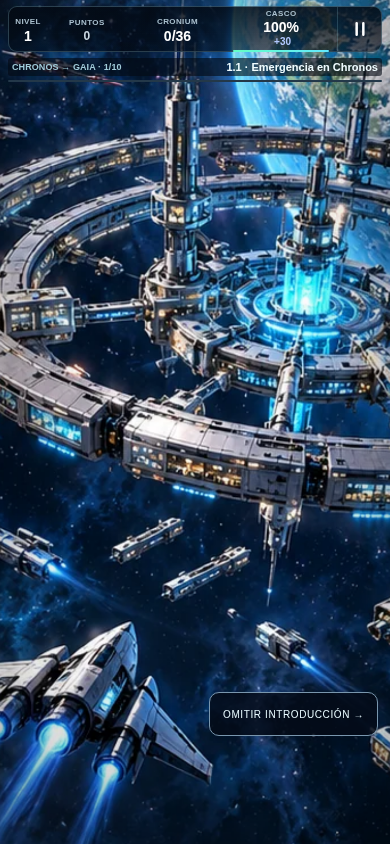 |
| C9 antes y después de comprar con chatarra obtenida en vuelo | 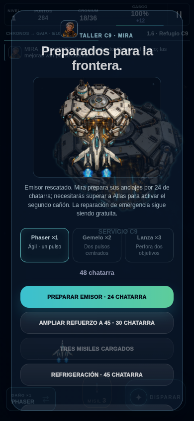 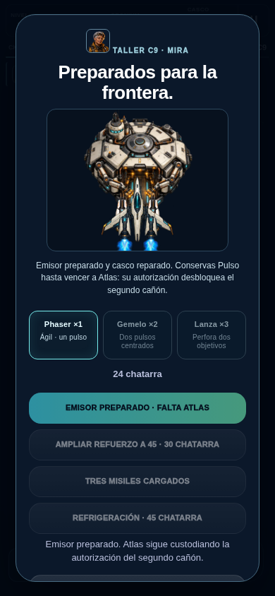 |
| Misil físico y segunda fase | 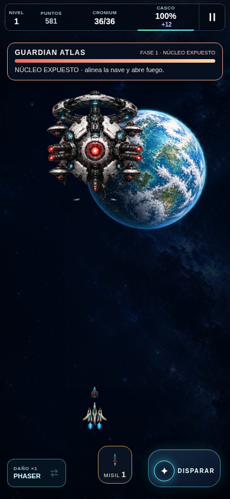 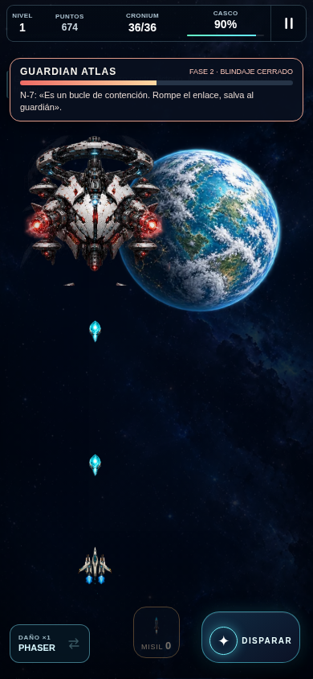 |
| Resolución y llegada persistida | 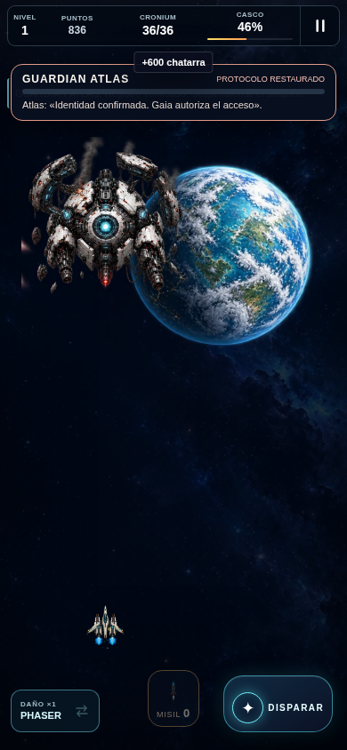 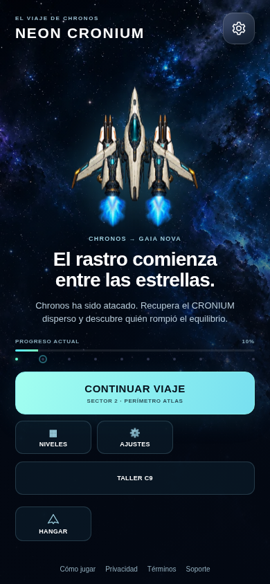 |

### Partida natural del SHA final `f634a46`

| Momento real | Captura del ejecutable |
| --- | --- |
| Huida y persecución | 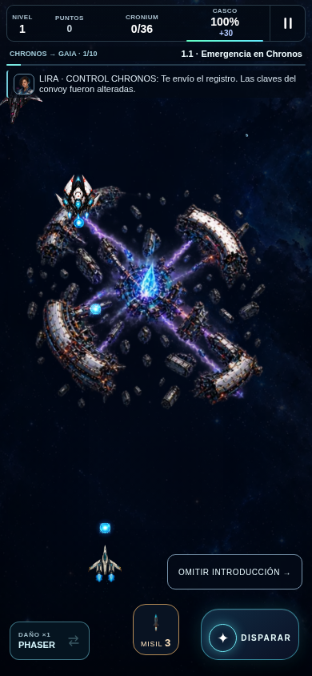 |
| Misil físico | 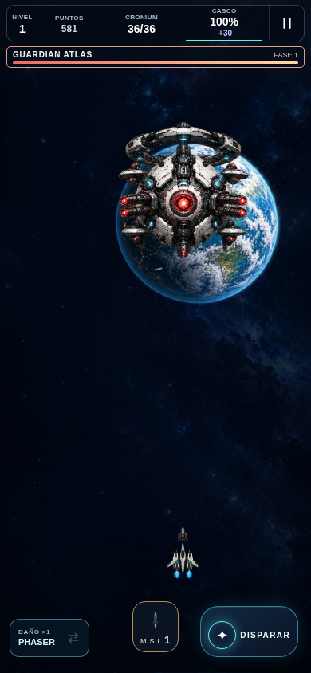 |
| Desenlace Iria y llegada | 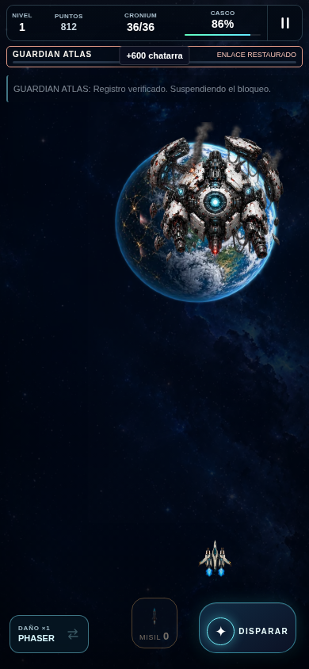 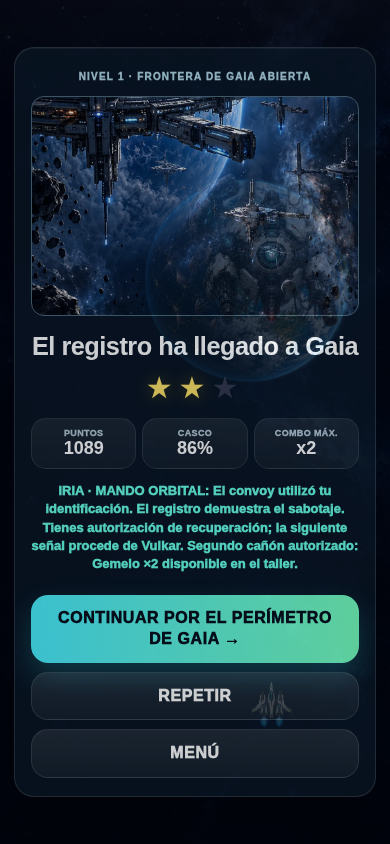 |

### Fixture visual final del SHA `f634a46`

Estas escenas utilizan checkpoints preparados para revisar encuadre y transacciones; no son otra partida natural. Se muestran controles y diálogo en ambos tamaños.

| Vista | 390×844 | 320×568 |
| --- | --- | --- |
| Nave y controles separados | 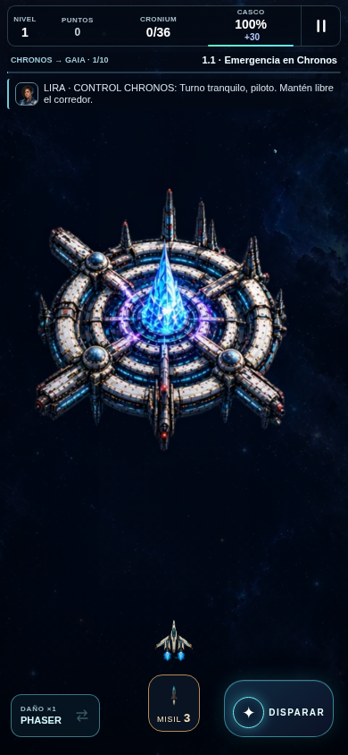 | 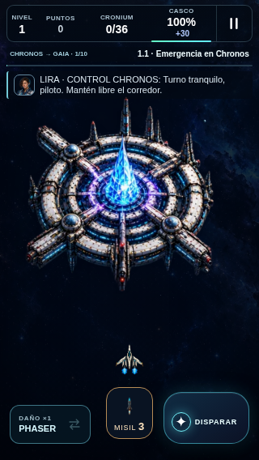 |
| Núcleo de Atlas expuesto | 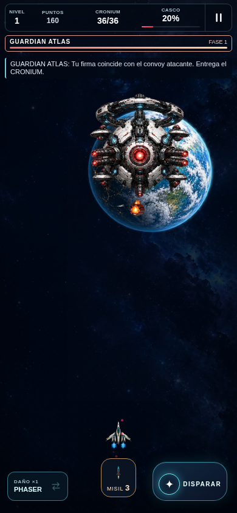 | 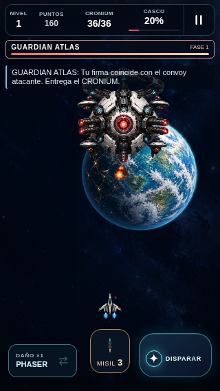 |
| Iria sin panel encima | 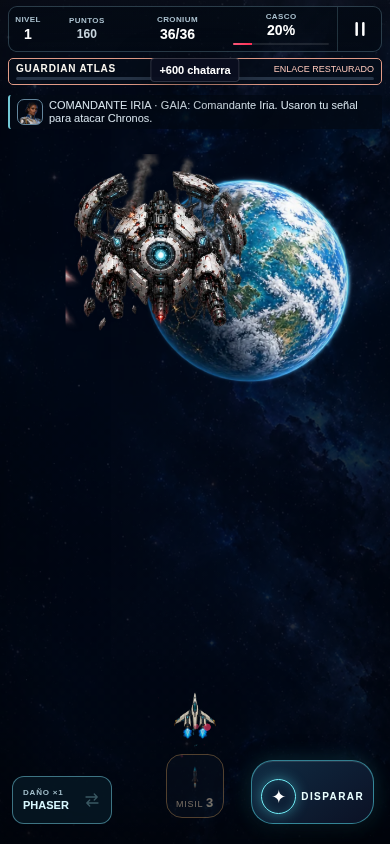 | 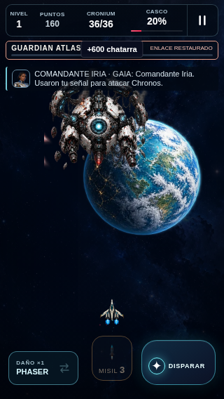 |

### Comparación histórica C9

El antes es una captura real de `b2a89f694215bddba3a5ba2f6d1a68a03c70cccd`, acreditado por su [resultado original](evidence/main-salvage-combat/c9/results.json). El después procede del fixture final `f634a46`. Son escenarios preparados distintos, con estado y compras diferentes: sirven para revisar la presentación y los servicios, no como comparación controlada de rendimiento ni como una misma compra.

| Antes: C9 histórico | Después: C9 final tras pagar refuerzo y dos misiles |
| --- | --- |
| 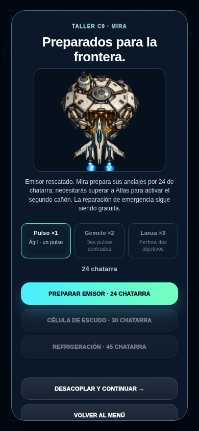 | 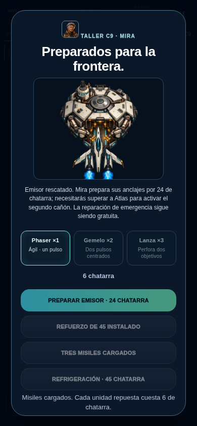 |

La regresión pequeña también queda visible: [solapamiento anterior de 11 px](evidence/chapter1-living/visual-968-failure/320x568-failure.png), frente al control separado de 320×568 mostrado arriba. No se fabrica un montaje para disimular diferencias de escena.

Inventario actual: **92 recursos runtime**, **11.026.222 B**; catálogo de producción **164 entradas**. El catálogo incluye trabajo pendiente y no equivale a 164 assets terminados. Las estimaciones de RGBA/PCM se detallan arriba. Los tres atlas nuevos son de carga diferida; una vez usados, las referenciasImage se retienen durante la página. No hay liberación específica de la textura de introducción después del plano; su límite incremental estimado es10,75MiB para esos tres atlas, no para todo el juego. El audio usa media elements y el contexto compartido. Entorno localNode24.19.0 yChromium154; CIusaNode22.13.0 delworkflow. No se midió tiempo puro de carga(el paso inicial incluye controles ycinemática), memoria total del proceso, FPS sostenido en dispositivo, consumo energético ni Retina física; no se certifican 60 FPS o estabilidad de iPhone mediante Chromium de software.

## 9. GitHub, paquete y publicación

Commits publicados por push normal en la rama autorizada:

1. [`195716d`](https://github.com/adonay1994sm-gif/Ne-n-catcher/commit/195716d80ceeb83ced75ed8130e8ebf860923fb1): capítulo vivo, reserva, misiles, recursos y Atlas orbital.
2. [`3547147`](https://github.com/adonay1994sm-gif/Ne-n-catcher/commit/35471470cb94a2ba1ec37e230c95646b189a06fe): preservación del daño potente a través del dispatcher y prueba de integración.
3. [`968ebc8`](https://github.com/adonay1994sm-gif/Ne-n-catcher/commit/968ebc8b861409f157fb797f249b709669f99d4d): HUD compacto que deja espacio al canal de personajes.
4. [`f634a46`](https://github.com/adonay1994sm-gif/Ne-n-catcher/commit/f634a4635c4faacd33d19390706e0a97d1198662): separación táctil en pantallas pequeñas y script reproducible de QA visual.

GitHub Actions de `968ebc8`: **39120123173, success**. La ejecución final de aplicación `f634a46`, **39120714906**, está **completed/success**. El recibo de cierre documental registrará por separado su propio SHA y ejecución.

Preview local limpia actual: `f634a46`, revisión **`1d3776f68358c21fb98c39b99842d0e170f715a8a92f0b82f5b817fb4ba2e83e`**. Esa revisión es la huella del contenido de preview, distinta del SHA-256 del ZIP. Los datos se comprobaron contra el ZIP real y su [recibo conservado](evidence/chapter1-living/package-final.json).

- ZIP de distribución: `/workspace/artifacts/NEON-CRONIUM-CAPITULO-1-f634a46.zip`.
- Peso y entradas: **11.327.979 B**, **128 entradas**.
- SHA-256 del ZIP comprobado: **`5153eb0c06b9b5aea4ed40b05532178af1d9041ed84cab28f604da64e205b18a`**.
- Uso: extraer conservando la estructura y servir por HTTP desde la raíz; abrir `index.html` y CONTINUAR VIAJE. El juego queda en `juego/`. No se considera probado como `file://`. La publicación remota y actualización/offline7/7 incluyen los cincoassetsnuevos. Servir elZIP: `python3 -m http.server 8000 --directory RUTA_EXTRAIDA`; abrir `http://localhost:8000/`. No hay despliegueNetlify nuevo.
- Site privado **versión20**, fuente`a5c735e2c034f8fe81b288d52b290292a712c362`, deployment`appgdep_6ad4a533538c8191aa04996e6c0f0fc5`: **succeeded**. [Recibo](evidence/chapter1-living/site-publication.json).
- HTTP y hashes remotos: **12/12 aprobados**; comparación exacta de juego, contenido, tres atlas nuevos, dos anteriores y dos AAC. [Resultados](evidence/chapter1-living/site-http/results.json).
- URL comprobada: **https://neon-catcher-pruebas.chictide18.chatgpt.site**. CONTINUAR VIAJE abre el paquete actual; para repetir la apertura desde un checkpoint avanzado: NIVELES → La Onda de Choque →1.1. Misma audiencia privada: propietario, sin editores, grupos o visitantes externos. No se jugó a distancia usando la cuenta del propietario; el juego se probó sobre su paquete idéntico local.
- Destino comprobado por integración: privado para el propietario, una persona autorizada y sin audiencia externa. No autoriza producción.
- Netlify producción: sin cambios; no se inventa un despliegue o una URL nueva.

La evidencia ya copiada está en `docs/production-reports/evidence/chapter1-living/`: certificaciones, natural `3547147`, fallo visual anterior, repetición final, iteraciones, paquete, CI histórico y archivos modificados. La partida final está en `natural-f634a46/` y HTTP en `site-http/`. La prueba offline final está en `offline-f634a46/`; los intentos01/02 con contratos incorrectos del arnés permanecen separados, con límites de fixtures explícitos. No subir secretos, tokens o credenciales.

## 10. Seguimiento y siguiente entrega

Registro reconciliado: las **siete tareas actuales implementadas** del lote permanecen **IN_REVIEW**, con aceptación técnica delimitada por SHA y entorno; artística **PENDING_OWNER** y física **PENDING**. La octava entrada, arsenal futuro de 10–15 armas, conserva **PENDING / NOT_IMPLEMENTED**. No se marca DONE por la presencia de una definición, un atlas o una prueba simulada.

Estado de cierre y trabajo siguiente:

1. Partida natural final4/4, CI39120714906success y QAvisual6/6 ya registradas; conservar ambas partidas354/f634con susSHA propios. Cierre documental posterior se identifica en el recibo.
2. Actualización/offline final7/7 verificada. Mantener la distinción entre fixtures de compatibilidad y el inicio fresco offline.
3. Publicación privada20/HTTP12/12 y ZIP comprobados; completar únicamente recibo documental y CI de cierre. No producciónNetlify.
4. Revisión estética del propietario, escucha humana y balance del capítulo con jugadores.
5. Safari/iPhone físico, interrupción de aplicación, memoria y rendimiento medidos.
6. Evaluar la rareza monetaria a escala de campaña y el ritmo real de un primer capítulo de aproximadamente ocho minutos observado por el piloto.
7. Integrar o descartar explícitamente las poses nuevas de impacto/restos del misil 8–15; actualmente se reutilizan los VFX de Gaia.
8. Sólo después, continuar el territorio Gaia y sus conexiones posteriores, con argumento y guardianes propios. No se han terminado cien etapas, diez jefes o diez territorios visualmente completos.

Riesgos y decisiones reservadas: legibilidad de la nave reducida en pantallas físicas; encuadre del HUD en orientaciones no cubiertas; dificultad humana frente a un piloto automatizado; mezcla y compatibilidad Safari del audio; progresión económica estelar extremadamente rara; aceptación artística; decisión del Motor V1 reservada al propietario. El dato público de soporte sigue pendiente por decisión del propietario y no se vuelve a solicitar en esta entrega.

## 11. Referencias de continuidad

- [Visión vigente](../PRODUCT_VISION.md), [registro único de tareas](../production-tasks.json) y [guion/diseño del capítulo 1](../design/CHAPTER_01_CHRONOS_GAIA.md).
- [Procedencia y estados gráficos](../../art-source/chapter1-rebirth/README.md) y [composición, síntesis y límites del audio](../../art-source/audio/chapter1-score/README.md).
- Los informes previos, sus capturas y el Site versión 19 conservan valor histórico; no acreditan esta compilación. Se conserva el mismo origen para guardar partidas, pero cada publicación nueva acredita su SHA y contenido mediante recibos y hashes propios.
