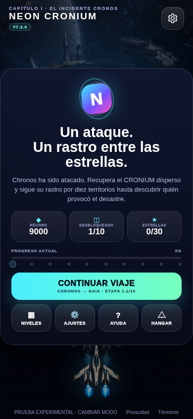

# DIAGNÓSTICO

Fecha: 17/10/2026 UTC. Rama: `continuity-assets-audit-20261013`.
SHA inicial de este refuerzo: `24c8b43c77b6b92212736f225d0aa3b13f4fbf36`, remoto y árbol limpios. SHA inicial del lote completo: `827c1b5f50d88cbca5f68924d6ffc71f0794074e`.

La revisión final de [la entrega Chronos–Gaia](VOYAGE_POLISH_2026-10-17.md) reprodujo un defecto real antes del journal: al fallar la lectura del récord actual de 9000, la migración interpretaba 0 y escribía el histórico de 100. [Función anterior y reproducción](evidence/score-read-guard/reproduction-before.json). Una lectura denegada no equivale a dato ausente. La misma comparación con fallback existía al guardar una derrota; se corrigieron ambas rutas sin alterar el combate.

# INFORME DE PRODUCCIÓN — NEON CRONIUM

Estado: corrección integrada, regresión y Actions completos, paquete limpio y web privada **versión 14** publicada. Esto cierra el defecto reproducido; no declara la campaña comercial terminada.

- SHA funcional probado/publicado: [`f39082f04667d7dc18ceba17705095bacb30806e`](https://github.com/adonay1994sm-gif/Ne-n-catcher/commit/f39082f04667d7dc18ceba17705095bacb30806e).
- Cierre documental: el commit que contiene este informe y su recibo posterior `evidence/score-read-guard/closure.json`; se distinguen del binario probado.
- Tiempo: se conservan marcas UTC y duración de comandos en evidencias; no se atribuyen horas de trabajo humano no medidas.
- Bloques: P2, persistencia de récords y regresión de la edición privada. No se cambia ninguna etapa, semilla, colisión, arma, duración, ritmo o motor.

## A. Experiencia y trabajo ejecutado

1. `migrateLegacyStorage` lee histórico y actual una vez mediante `readRaw`. Si cualquiera es ilegible, no escribe. Si el actual es no numérico o no finito y no vacío, conserva su raw; la migración legítima de un récord superior sigue funcionando. La ausencia/vacío real mantiene el cero compatible.
2. `saveScore`, utilizado por la derrota, lee y valida ambos registros antes de escribir. Lectura denegada, JSON inválido o puntuación inválida devuelven fallo y conservan datos. Mantiene máximos, otros niveles y claves independientes. No se borran registros para ocultar corrupción.
3. Dos pruebas del bootstrap completo verifican el caso 9000/100 con y sin intención pendiente, recuperación posterior y finalización idempotente. Veintiséis pruebas nuevas verifican las funciones reales y el facade real, no una copia de su implementación.
4. Pipeline regenera bundles web/iOS; preview incorpora la corrección, generación nueva de caché y procedencia exacta. Ningún parche exclusivo de bundle.

Se mantienen la nueva C9 ilustrada, selección Pulso/Gemelo/Lanza, Gaia bajo el HUD, cuatro partituras originales y reducción de sacudidas/destellos de la entrega anterior. [Informe, galería y partidas de ese lote](VOYAGE_POLISH_2026-10-17.md). No se añaden assets en este refuerzo.

## B. Archivos y sistemas

[Relación precisa de 9 archivos del commit funcional](evidence/score-read-guard/changed-files.json):

- `src/game/01-runtime-assets.js`: migración inicial.
- `src/game/03-ui-game-flow.js`: guardado después de derrota.
- `tests/legacy-score-migration.test.mjs`:11 casos.
- `tests/death-score-persistence.test.mjs`:15 casos.
- `tests/completion-journal-legacy.test.mjs`:7→9 casos integrados.
- `package.json`: ambas suites incluidas en `test:content`.
- `game.js`, `www/game.js`, `ios/App/App/public/game.js`: regenerados desde las fuentes.

No cambian loader, atlas, manifiestos de assets, renderer, niveles, audio ni geometría de colisión. [Comparación por hashes y funciones](evidence/score-read-guard/package/runtime-equivalence.json): excluyendo exactamente `migrateLegacyStorage` y `saveScore`, el resto del bundle es idéntico al 6cf67fc. Las partidas completas siguen atribuidas a sus commits originales; no se presentan como partidas nuevas sobre este binario.

El cierre documental actualiza el registro principal, checklist/progreso generados, guías de estado/continuación y enlaces de informes previos; conserva sus secciones históricas.

## C. Pruebas ejecutadas

Todos los comandos siguientes terminaron con salida 0 salvo el primer intento de arnés expresamente conservado. [Certificación limpia y comandos exactos](evidence/score-read-guard/certificate/results.json): HEAD f39082f, árbol vacío, 11/11 fases.

| Comando / alcance | Resultado | Evidencia |
| --- | --- | --- |
| `node scripts/certify-local.mjs /tmp/neon-cronium-score-guard-certificate` |11/11 fases |[JSON](evidence/score-read-guard/certificate/results.json) |
| `npm run build` |Build y espejos correctos |[build](evidence/score-read-guard/certificate/build.txt) |
| `npm run test:engine` / `test:architecture` |60/60 y 6/6 |[motor](evidence/score-read-guard/certificate/engine.txt), [arquitectura](evidence/score-read-guard/certificate/architecture.txt) |
| `npm run test:content` |297/297 |[contenido](evidence/score-read-guard/certificate/content-integration-assets.txt) |
| `npm run test:static` / `npm test` |13/13 y 34/34 |[estáticos](evidence/score-read-guard/certificate/static.txt), [regresión](evidence/score-read-guard/certificate/regression.txt) |
| `node tests/run-v7-web-tests.mjs` |13/13 |[web](evidence/score-read-guard/certificate/web.txt) |
| Adaptadores experimentales aislados / audio lifecycle / artpass |14/14, 3/3 y 12/12 |[certificación](evidence/score-read-guard/certificate/results.json) |
| `node scripts/audit-asset-inventory.mjs` |83 recursos, 0 errores |[inventario](evidence/score-read-guard/certificate/inventory.txt) |
| `npm run build:preview` / `npm run test:preview` |Paquete limpio;23/23 |[build](evidence/score-read-guard/build-preview.txt), [preview](evidence/score-read-guard/preview-23.txt) |
| Cuatro suites focalizadas de persistencia sobre build regenerado |60/60 |[registro](evidence/score-read-guard/focused-60.txt) |
| Chromium: arranque con lectura actual denegada, histórica denegada, raw NaN y migración válida |4/4; 0 errores JS |[resultados y arnés](evidence/score-read-guard/browser-02/results.json) |
| Chromium: actualización real v13→v14, workers nativos y continuación offline 1.3 |5/5 |[resultados](evidence/score-read-guard/upgrade-v13/results.json) |
| Chromium: C9/armas/contraste/scroll 320 y atlas offline |1/1 |[resultado](evidence/score-read-guard/c9/results.json) |
| Chromium: home preservada→clásico exacto→jugar/pausa, ruta orbital accesible |2/2 |[navegación](evidence/score-read-guard/site-navigation/results.json) |
| Chromium: regresión N-7 |1 sesión/6 pasos; no 100 misiones jugadas |[resultado](evidence/score-read-guard/n7/results.json) |
| HTTP remoto autenticado: portada, build-info y bundle actuales |3/3 HTTP 200; SHA y hash exactos |[comprobación remota](evidence/score-read-guard/remote-http.json) |

Comandos de navegador conservados: `node /tmp/neon-score-recovery-browser.cjs preview-dist /tmp/neon-cronium-score-guard-browser-02 f39082f04667d7dc18ceba17705095bacb30806e`; `node scripts/rebrand-browser-smoke.cjs --root preview-dist --previous /tmp/neon-cronium-polish-final/preview-dist --output /tmp/neon-cronium-score-guard-upgrade --timeout 180000`; `node scripts/voyage-polish-browser-smoke.cjs --root preview-dist --output /tmp/neon-cronium-score-guard-c9 --focus-c9 --expected-commit f39082f04667d7dc18ceba17705095bacb30806e`; `node scripts/content-browser-smoke.cjs --root preview-dist --output /tmp/neon-cronium-score-guard-n7 --profile 390x844 --mode n7`. Los arneses temporales usados se conservan junto a resultados para reproducirlos con rutas locales válidas.

GitHub Actions **completo/success**, incluido `npm ci` en Node 22.13 y empaquetado: [39074965794](https://github.com/adonay1994sm-gif/Ne-n-catcher/actions/runs/39074965794). [Metadatos con SHA y pasos](evidence/score-read-guard/github-functional.json). Certificación local usa Node 24.19; no se equipara ninguna a iPhone físico.

### Fallos y correcciones de esta comprobación

El [primer arnés Chromium](evidence/score-read-guard/browser-attempt-01/results.json) terminó salida 1 después de aprobar el caso del récord 9000. Esperaba erróneamente 9000 incluso al restaurar una lectura histórica legítima de 12000. El producto correctamente migró 12000. Se corrigió el resultado esperado tras la recuperación, manteniendo las aserciones de cero escrituras durante la denegación y de migración válida posterior. No se cambió runtime para conseguir verde. La repetición pasa 4/4. Los fallos anteriores del lote visual y del piloto Pulso continúan en el informe histórico.

## D. Paquete y web

- ZIP: [neon-cronium-score-guard-f39082f.zip](evidence/score-read-guard/package/neon-cronium-score-guard-f39082f.zip).
- SHA-256: `9e84933240081b7b767bd25272cc92f91364fc424cddc7318c907099c66d4000`.
- Peso: 8.504.676 B; 119 entradas. Revisión: `8bbfa6fb32c6d1ca12369f84e16b8bc4ff8e11559c459a094eca1f78cc5db72e`; `dirty:false`.
- Abrir `index.html` o `juego/index.html` desde un servidor; para NetlifyDrop subir el contenido completo del ZIP a un destino de pruebas explícito. No se creó un despliegue Netlify ni se alteró producción.
- Web privada: **https://neon-catcher-pruebas.chictide18.chatgpt.site**, versión 14, `succeeded` 2026-10-17T22:29:15.384509+00:00. CONTINUAR VIAJE abre `/clasico-actual/juego/index.html`.
- Fuente Site: `5f06e6343f187cc0d689289e2000120c0a33660d`; [recibo nativo](evidence/score-read-guard/site-deployment.json).
- 147 archivos externos existentes idénticos por SHA-256; misión orbital/fuentes/licencias/entrada histórica preservadas. 119 archivos del clásico coinciden con el paquete probado. [Prueba de conservación](evidence/score-read-guard/site-preservation.json).
- Audiencia owner-private mantenida, un propietario y cero visitantes externos; no invitaciones. URL y bundle remoto comprobados por HTTP autenticado. Esto no es una partida remota completa ni una certificación de la misión orbital ajena.

Captura auténtica del ejecutable en Chromium. [C9 y resto de capturas de este paquete](evidence/score-read-guard/c9/); [comparaciones antes/después y partidas anteriores](VOYAGE_POLISH_2026-10-17.md). No se presentan conceptos como capturas de juego.

## E. Estado, límites y continuación

`P2-SAVE-01` conserva DONE técnico y añade el cierre de ambas rutas previas/externas al journal. No se incrementa artificialmente el número de tareas terminadas. Registro único de 314 tareas: 26 DONE, 72 IN_REVIEW, 5 IN_PROGRESS, 203 PENDING, 8 BLOCKED. Estos estados históricos no son un porcentaje comercial. Presentación/audio siguen IN_REVIEW por aceptación del propietario; prueba humana sigue BLOCKED con protocolo preparado, cero personas probadas.

La protección de derrota sigue siendo dos escrituras: si mejora el global y falla después el récord por nivel, devuelve fallo y conserva el global mejorado. No promete atomicidad, CAS entre pestañas, recuperación de una intención nunca persistida ni premios externos. El journal de finalización conserva su alcance separado. La migración conserva raw no numérico/no finito no vacío; mantiene la compatibilidad histórica de negativos normalizados a cero y puede sustituirlos por un histórico positivo. El guardado de derrota rechaza valores negativos. No se afirma que la UI pueda mostrar un récord ilegible.

Rendimiento: este refuerzo no añade texturas, audio, RAF ni temporizadores. El atlas C9 de la entrega previa estima 4 MiB RGBA; el inventario permanece en 83 recursos/8.272.028 B. Duraciones de scripts están registradas, pero no son tiempo de carga ni benchmark móvil. Sin medición nueva de FPS/memoria GPU/temperatura sostenida, Safari físico, iPhone físico, Xcode Archive ni sesiones humanas.

Contacto: Adonay Sánchez Melo, España, datos facilitados por el propietario. Correo aplazado expresamente; no se publica una política o soporte comercial definitivo ni se solicita de nuevo para continuar tareas independientes.

Siguiente tarea exacta: revisar presentación/audio de C9 y Gaia con el propietario y ejecutar el protocolo humano preparado; en producción independiente, crear CH-02 de Gaia con atlas/estados reales y entrada natural antes de Atlas, verificar un combate completo y después CH-03. Siguen pendientes las familias/jefes del resto de mundos, trama/final, cien etapas canónicas runtime, balance humano, rendimiento físico y distribución autorizada. No se expanden cien rutas por repetición de fondos.

Motor V1 = `false`, un único RAF. No main, PR #3, force push, producción Netlify, App Store/TestFlight, pagos, anuncios reales ni gastos nuevos. Commits y maestros anteriores recuperables. Este cierre permite continuar sin leer conversaciones privadas.
