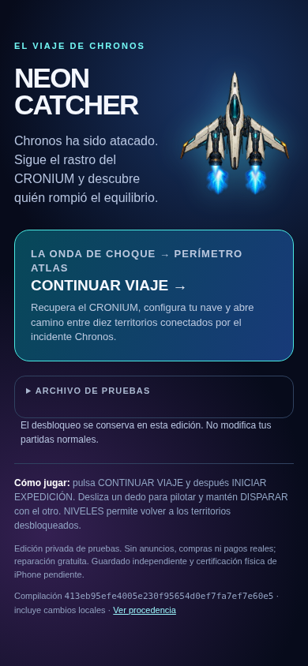
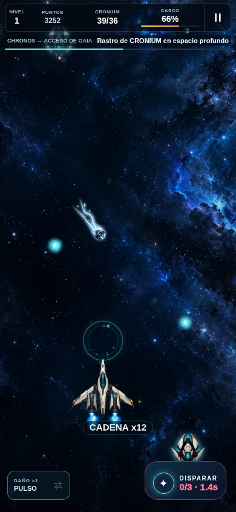

# DIAGNÓSTICO — Nave única, cometa y control con dos dedos

**Fecha:** 17 de octubre de 2026. **Rama:** `continuity-assets-audit-20261013`.

El propietario eligió la nave modular actual como base visual definitiva y señaló dos defectos concretos: la portada seguía mostrando la nave original, ajena al aspecto del gameplay, y no resultaba posible pilotar y disparar correctamente con dos dedos. También pidió mejorar los cometas. Esta entrega cierra ese incremento de presentación y control; no declara terminada la campaña ni una versión comercial certificada.

El punto de partida de la sesión fue `413eb95efe4005e230f95654d0ef7fa7ef7e60e5`, con árbol limpio y remoto comprobado. La comparación de controles utiliza además el paquete anterior publicado `d93b1352c9a036ccec0fc6337b02e41acd8a7832`, identificado como tal: no se confundió ese paquete con el HEAD inicial ni se volvió atrás en la rama.

La reproducción válida anterior confirmó el problema: con el dedo de pilotaje apoyado, el segundo contacto llegaba a DISPARAR como `pointerdown` no primario, pero no emitía inmediatamente ni mantenía el disparo. La portada solicitaba otro dibujo de nave. El cometa anterior tenía apariencia de roca incandescente y su orientación diagonal añadía un cuarto de vuelta a un ángulo ya calculado desde la velocidad.

Se conserva el motor legacy, `USE_ENGINE_V1 = false`, el propietario único de RAF, las campañas anteriores y los guardados. No se tocó main del juego, la PR #3, producción Netlify ni publicación móvil.

# INFORME DE PRODUCCIÓN — NEON CRONIUM

**Entrega:** SHIP_TOUCH_COMET · identidad modular elegida, cometa mineral y pilotaje con dos contactos.

| Campo | Resultado |
| --- | --- |
| Fecha | 2026-10-17, UTC. No se atribuyen horas de trabajo no medidas. |
| Rama de integración | `continuity-assets-audit-20261013` |
| SHA inicial | `413eb95efe4005e230f95654d0ef7fa7ef7e60e5` |
| SHA funcional | `d325e51f19df0dd1e77ab9257ddcdeee775299be` |
| Corrección del contrato web | `53a8244db58227eee8cc32463a0593eee69ce3bd` |
| Commit de evidencias y QA / paquete limpio | `f543056e4bcbd611674926713a899d42a5879144` |
| SHA de paquete final limpio | `f543056e4bcbd611674926713a899d42a5879144`; `dirty=false`, revisión `126430c4b02fee964f1f11827544925a66f1c6b9503486c16990855b2f1486fb`. |
| SHA de cierre documental | Se registra tras el commit en [closure.json](evidence/ship-controls/closure.json); el paquete limpio se identifica de forma independiente. |
| Sitio de pruebas | Versión **9**, publicación privada **succeeded** a las 20:04:54.585578 UTC. Fuente del sitio `b62289496b9da7cee168924e5f79a56923b1301f`. |
| Niveles trabajados | Presentación y controles compartidos; partida natural de Chronos → C9 → Gaia y regresión de apertura de los diez escenarios. |
| Aceptación artística | Base modular elegida por el propietario. Cometa nuevo y acabado de esta entrega pendientes de revisión estética. |
| Prueba física | Safari/iPhone físico no ejecutados. |

## A. Experiencia que realmente puede jugarse

La misma nave modular aparece en portada, menús y partida. Se ha retirado la alternativa visual antigua del uso normal; sus archivos siguen recuperables para conservar historial y referencias reservadas.

El jugador puede arrastrar un dedo para pilotar y apoyar o mantener otro en DISPARAR. El disparo comienza al apoyar el contacto de acción; mantenerlo utiliza las tres cargas y sus recargas, respetando la cadencia del arma. Se puede iniciar la pulsación con la batería vacía: la intención permanece registrada y el arma dispara al recuperar una carga. Soltar un contacto no roba el otro. Pausa, reinicio, cancelación y pérdida de foco limpian los contactos pendientes.

Los cometas tienen un núcleo mineral helado, vapor y fragmentos ilustrados que cambian en cuatro fotogramas. La cola sigue la dirección del vuelo y es decorativa. La colisión conserva el núcleo y los radios anteriores.

El recorrido existente sigue siendo jugable. La prueba natural empezó sin desbloqueos ni guardados preparados, presenció el incidente, recuperó la pieza, completó Chronos, instaló Gemelo en C9 y continuó hacia Gaia. Se verificó después la persistencia al recargar. Este lote no reescribe la historia ni presenta cien etapas como terminadas.

## B. Requisitos confirmados y decisiones de implementación

| Origen | Decisión y resultado |
| --- | --- |
| Petición expresa del propietario | Consolidar la versión y retirar la nave original de la experiencia visible. Se usa la identidad modular ya elegida. |
| Petición expresa del propietario | Mejorar los cometas. Se produjo un atlas original y se integró en el renderizador real. |
| Defecto comunicado | No se puede jugar con dos dedos. Se separaron propiedad de pilotaje y acción, tanto con PointerEvents como con el fallback TouchEvents. |
| Decisión reversible de trabajo | Mantener DISPARAR repite desde el ciclo existente, sujeto a batería y cadencia; no crea un timer de combate ni otro RAF. |
| Decisión reversible de trabajo | Cometa de cuatro poses, 8 FPS, bucle de 0,5 s con el reloj jugado; escala de celda `item.r * 12`. |
| Conservación del proyecto | Los seis frames antiguos de nave y el cometa anterior permanecen en disco e inventario, retirados de carga activa y precaché. |
| Límite de aceptación | «Definitiva» identifica la base visual elegida. No equivale a cierre artístico de diez niveles, certificación iPhone o publicación comercial. |

## C. Implementación e integración

### Identidad de la nave

El launcher, la pantalla de misión y el menú utilizan `assets/player_ship_identity_v1.webp`. El retrato procede de una exportación determinista de `drawModularShip` y sus componentes reales; no es un concepto independiente que se parezca a la nave. El gameplay conserva la animación modular de su atlas original.

`src/game/01-runtime-assets.js` establece la representación modular. Un perfil antiguo que conservaba la opción legacy mantiene equipamiento y progreso, pero deja de activar esa apariencia. La selección antigua se retira del hangar. Los frames anteriores ya no se solicitan en la ruta normal. La pose de emergencia usa el nuevo retrato si el atlas modular todavía no está disponible.

También se corrigió una franja cian entre las dos llamas de los motores: el ensamblador compone los chorros ilustrados izquierdo y derecho sin copiar la banda central contaminada del recurso. No se desplazaron los anclajes ni se cambió el casco de colisión.

### Dos dedos, carga y ciclo de vida

`src/game/08-loop-input-bootstrap.js` mantiene identificadores independientes de pilotaje y fuego. El segundo contacto puede ser no primario. El fallback TouchEvents busca el identificador correcto en `changedTouches`. Un tercer contacto no puede apropiarse del control existente.

El disparo responde a la pulsación inicial, con supresión del clic de compatibilidad para no gastar dos cargas. Mantener la acción se evalúa desde `frame()`. Se conservan clic, teclado y accesibilidad. El botón sigue recibiendo contactos mientras recarga; `aria-disabled` informa la indisponibilidad y la lógica del arma impide disparos inválidos. Deshabilitar físicamente el botón con cero cargas habría impedido registrar la pulsación mantenida hasta la recarga.

`resetGameInput()` libera los dos propietarios en las transiciones pertinentes, pausa, reinicio, desenlace, blur y segundo plano. La liberación de fuego no cancela el pilotaje ni viceversa. Las llamadas de cierre de nivel se realizan después de verificar que el cierre realmente procede: recoger un orbe antes de cumplir el objetivo no cancela el movimiento.

El ajuste es deliberadamente compartido con las rutas conservadas; por eso se ejecutó también regresión N-7. No se alteraron sus semillas, director de oleadas ni claves de guardado.

### Cometa animado

El loader apunta a `assets/comet_flight_atlas_v2.webp`. `drawMeteor` selecciona una de cuatro celdas mediante tiempo jugado, con pivote fijo en el núcleo. Para cometas de vuelo usa `atan2(vy, vx)`; para caída vertical, `π/2`. Esto elimina la rotación adicional incorrecta. El mapa `ANIMATION_MAP.cometFlight.travel` documenta celdas, duración y pivote.

La cola se orienta hacia atrás y cambia de filamentos y fragmentos entre poses. El núcleo visible conserva el tamaño ligado a `item.r`; `collisionCircles` continúa usando el radio anterior `item.r * .94`. No se convirtieron cola o brillo en una hitbox. No se modificaron daño, premios o trayectoria para adaptar la ilustración.

## D. Recursos producidos y trazabilidad

| Recurso | Maestro | Runtime y dimensiones | Fotogramas, pivote y uso |
| --- | --- | --- | --- |
| Astér · retrato del ensamblaje real | `art-source/ship-identity/player_ship_identity_v1.png`, PNG RGBA, 1024 × 1280 | `assets/player_ship_identity_v1.webp`, RGBA, 512 × 640, **67.122 bytes** | 1 pose estática; pivote maestro (512,512), runtime (256,256). Portada y fallback. La nave de partida sigue animando sus componentes. |
| Cometa mineral helado v2 | `art-source/comet-rework/comet_flight_atlas_master.png`, PNG RGBA, 2048 × 512; 4 celdas de 512² | `assets/comet_flight_atlas_v2.webp`, WebP lossless RGBA, 1536 × 384; 4 celdas de 384²; **151.882 bytes** | 4 poses diferentes; 8 FPS, 0,5 s. Pivote por celda (288,192), normalizado (0,75;0,5). Cabeza +X, cola −X. |

SHA-256 del retrato: `bd22a7d85ccc774c3b5e5fdb219ba417febf547ddc3f08541ac8fa083ae68413`.

SHA-256 del cometa: `6d2989e816f6817c6b979395e299f19a32ba1d344904c4b727579f77d896ad6d`.

El retrato reutiliza `ship_modular_atlas_v1.webp`. `scripts/export-modular-ship-portrait.cjs` conserva el proceso de exportación con el ensamblador real. La ficha `art-source/ship-identity/player_ship_identity_v1.json` guarda atlas, hashes, loadout y alcance exacto del fragmento de código utilizado.

El cometa procede de generación original con la herramienta disponible `image_gen.imagegen`, sin recursos de franquicias ni terceros añadidos. Se conservan la primera generación descartada, la fuente elegida, los cuatro estados PNG, el atlas maestro, prompts exactos y `export.sh`. La primera propuesta se descartó por halo excesivo y separación insuficiente. Los cuatro frames finales tienen hashes RGBA diferentes y esquinas transparentes. La procedencia no equivale a revisión legal independiente.

`art-source/comet-rework/review_on_space.png` es una composición de revisión de arte, **no una captura del juego**. La integración real está documentada en las capturas de `natural-01`.

`ASSET_MANIFEST.json` contiene **82 recursos empaquetados**, 7.956.026 bytes. El inventario pasó con 58 READY y 24 IN_REVIEW; siete recursos se conservan fuera de precaché. `ASSET_PRODUCTION_150.json` conserva **155 identificadores**: no se completó artificialmente el catálogo. El registro histórico del cometa anterior se conserva; la nueva versión queda en revisión artística.

## E. Archivos y sistemas modificados

| Rutas | Cambio |
| --- | --- |
| `AGENTS.md`, `docs/PRODUCT_VISION.md` | Decisión vigente del propietario: identidad modular única y preservación de las restricciones anteriores. |
| `src/game/01-runtime-assets.js` | Recursos actuales, modo modular y carga no inmediata de frames retirados. |
| `src/game/03-ui-game-flow.js` | Retrato de menú/misión, hangar sin opción antigua, estado accesible del botón y limpieza de contactos en transiciones. |
| `src/game/07-player-item-rendering.js` | Nave modular única, corrección entre chorros, fallback actual y cometa orientado/animado. |
| `src/game/08-loop-input-bootstrap.js` | Propiedad separada de contactos, pulsación mantenida desde el RAF existente y liberación fiable. |
| `src/game/animation/animation-map.js` | Descripción de las cuatro poses del cometa; referencias reservadas anteriores conservadas. |
| `index.html`, `preview/launcher.html`, `styles.css` | Retrato real, portada coherente, ayuda de dos dedos y comportamiento táctil de DISPARAR. |
| `scripts/build-preview.mjs` | Comprobación y empaquetado del retrato nuevo para el launcher. |
| `scripts/export-modular-ship-portrait.cjs` | Exportación reproducible del ensamblaje modular. |
| `ASSET_MANIFEST.json`, `ASSET_PRODUCTION_150.json`, `sw.js` | Registro técnico, trazabilidad y precaché de recursos activos. |
| `tests/two-finger-input.test.mjs`, `tests/comet-presentation.test.mjs` | Contratos de contactos, batería, orientación, pivote, reloj y colisión. |
| `tests/ship-hangar.test.mjs`, `tests/ship-render-fallback.test.mjs` | Hangar e identidad actual, preservando las pruebas de equipamiento/fallback. |
| `tests/preview-build.test.mjs`, `tests/run-static-tests.mjs`, `tests/run-tests.mjs`, `tests/run-v7-web-tests.mjs`, `package.json` | Contratos actualizados de assets activos, referencias recuperables y suites de contenido. |
| `scripts/two-touch-browser-smoke.cjs` | Harness CDP de dos contactos, perfil nativo y fixture explícito TouchEvents. |
| `scripts/content-browser-smoke.cjs` | Medición de munición antes de toda la interacción, compatible con disparo en pointerdown. |
| `game.js`; `www/{game.js,index.html,styles.css,sw.js}`; `ios/App/App/public/{game.js,index.html,styles.css,sw.js}` | Bundles/copia pública regenerados desde las fuentes. No se mantienen parches exclusivos en las copias. |
| `art-source/ship-identity/`, `art-source/comet-rework/`, los dos nuevos WebP | Maestros, exportaciones, revisión y procedencia descritos arriba. |
| `docs/production-tasks.json`, `docs/PRODUCTION_MASTER_CHECKLIST.md`, `docs/PRODUCTION_PROGRESS.md` | Seguimiento reconciliado del incremento; el JSON sigue siendo fuente principal. |
| `docs/production-reports/evidence/ship-controls/` | Registros JSON, comandos, capturas reales, harness usado y fallos conservados. |

La versión de caché pasa a `neon-cronium-pre-release-7-2-0-ship-touch-comet-1`. Se retiran del CORE los seis `ship_frame_*.webp` y `comet_animation_sheet_v1.webp`; se añaden los recursos actuales. Los archivos retirados permanecen en el paquete recuperable y sus registros. El resultado no depende de borrar historial.

## F. Pruebas de fuentes y empaquetado

La corrida principal se ejecutó con Node `v24.19.0`, HEAD inicial `413eb95…` y **árbol con cambios locales de integración**. Eso consta en [certificate-01/results.json](evidence/ship-controls/certificate-01/results.json). Las capturas de navegador de esta fase identifican revisión de paquete `49be88f85e21008b7b08549378af6a52f2bee6f224da324720d2cf309d0fbd93`, `dirty=true`. No se las presenta como una certificación ejecutada sobre un commit limpio posterior.

| Comando exacto | Resultado y salida | Evidencia |
| --- | --- | --- |
| `npm run build` | 0 | [build.txt](evidence/ship-controls/certificate-01/build.txt) |
| `npm run test:engine` | 40/40; 0 | [engine.txt](evidence/ship-controls/certificate-01/engine.txt) |
| `npm run test:architecture` | 6/6; 0 | [architecture.txt](evidence/ship-controls/certificate-01/architecture.txt) |
| `npm run test:content` | 193/193; 0 | [content-integration-assets.txt](evidence/ship-controls/certificate-01/content-integration-assets.txt) |
| `npm run test:static` | 13/13; 0 | [static.txt](evidence/ship-controls/certificate-01/static.txt) |
| `npm test` | 33/33; 0 | [regression.txt](evidence/ship-controls/certificate-01/regression.txt) |
| `node tests/run-v7-web-tests.mjs` — primera corrida | Salida 1: contrato antiguo exigía precargar nave retirada | [web.txt](evidence/ship-controls/certificate-01/web.txt) |
| `node --test tests/campaign-adapter.test.mjs tests/neon-render-engine.test.mjs tests/sprite-animator.test.mjs` | 14/14; 0. Pruebas del código reservado, sin activarlo | [experimental-render-adapter.txt](evidence/ship-controls/certificate-01/experimental-render-adapter.txt) |
| `node --test tests/audio-lifecycle.test.mjs` | 3/3; 0 | [audio-lifecycle.txt](evidence/ship-controls/certificate-01/audio-lifecycle.txt) |
| `node --test tests/visual-artpass.test.mjs` | 12/12; 0 | [visual-artpass.txt](evidence/ship-controls/certificate-01/visual-artpass.txt) |
| `node scripts/audit-asset-inventory.mjs` | 82 recursos revisados; 0 | [inventory.txt](evidence/ship-controls/certificate-01/inventory.txt) |
| `npm run build:preview` | 0 | [build-preview.txt](evidence/ship-controls/build-01/build-preview.txt) |
| `npm run test:preview` | 23/23; 0 | [preview-tests.txt](evidence/ship-controls/build-01/preview-tests.txt) |
| `node --test tests/ship-hangar.test.mjs tests/ship-render-fallback.test.mjs` | 12/12; 0, fixture de fuentes | [identity-source-01/results.json](evidence/ship-controls/identity-source-01/results.json) |
| `node tests/run-v7-web-tests.mjs` — contrato corregido | 13/13; 0 | [web-contract-fix-02.txt](evidence/ship-controls/web-contract-fix-02.txt) |

El certificado principal tuvo **10 de 11 fases con salida 0**. La fase web fallida se corrigió y se volvió a ejecutar completa, con sus 13 casos aprobados. No hubo una segunda corrida global de las once fases; no se informa falsamente «11/11 en una única ejecución». Los casos de identidad, cometa y contactos incluidos en contenido se solapan con verificaciones individuales; no se suman como pruebas únicas adicionales.

El contrato corregido exige los assets activos y verifica también que los retirados siguen existiendo pero no se precargan. No se eliminaron aserciones para ocultar el cambio. Se corrigió además una referencia intermedia de test a `pose.engineScale`, inexistente, por el campo real `pose.enginePulse`; el intento fallido permanece en [web-contract-fix-01.txt](evidence/ship-controls/web-contract-fix-01.txt).

## G. Chromium real y alcance de la prueba

Todos estos comandos utilizan `preview-dist`, no únicamente `www`. Los JSON conservan comando completo, navegador, build-info, estado del árbol, capturas y límites del método. Los hooks añadidos por los servidores de prueba son de lectura; no se alteran los bundles distribuidos.

| Ejecución | Comando y resultado | Alcance |
| --- | --- | --- |
| Comparación anterior válida | `node scripts/two-touch-browser-smoke.cjs --root preview-dist --output docs/production-reports/evidence/ship-controls/touch-baseline-02 --baseline` → salida **1**, 4/7 grupos aprobados | Paquete previo `d93b135…`, limpio. Tres grupos y nueve aserciones fallidas reproducen el contrato nuevo incumplido. |
| Dos contactos integrados | `node scripts/two-touch-browser-smoke.cjs --root preview-dist --output docs/production-reports/evidence/ship-controls/touch-after-03 --fallback-fixture` → salida **0**, **14/14 grupos, 70 aserciones** | 7 grupos/35 aserciones mediante contactos CDP nativos; 7/35 mediante fixture de capacidad TouchEvents en Chromium. |
| HUD, vistas y navegación | `node scripts/compact-hud-browser-smoke.cjs --root preview-dist --output docs/production-reports/evidence/ship-controls/compact-01` → salida **0**, **26/26 grupos** | Cinco tamaños: 390×844, 320×568, 390×714, 844×390 y 1024×768; apertura de diez escenarios y controles. |
| Partida natural automatizada | `node scripts/unified-flight-browser-smoke.cjs --root preview-dist --output docs/production-reports/evidence/ship-controls/natural-01 --timeout 900000` → salida **0**, **5/5 comprobaciones** | Chronos → recuperación → llegada → C9 → instalación Gemelo → Gaia → persistencia. Sin preparar progreso ni insertar entidades. |
| Regresión N-7 | `node scripts/content-browser-smoke.cjs --root preview-dist --output docs/production-reports/evidence/ship-controls/n7-02 --profile 390x844 --mode n7` → salida **0**, **6/6 pasos**, 23.675 ms | Selector, movimiento/disparo, pausa, reanudación, reinicio conservando semilla y regreso. Ruta 37, versión `n7-waves-v2`, semilla `1467968345`. |

La corrida final de dos contactos duró **146.488 ms**. Cubrió ambos órdenes de apoyo, movimiento en los dos ejes mientras se dispara, liberación independiente, tres cargas, recarga con tiempo jugado, pulsación iniciada con batería vacía, cancelación, pausa/reanudación, reinicio y activación única por clic/teclado. No hubo errores JavaScript, consola ni peticiones fallidas, ni peticiones a `ship_frame_*.webp`. Máximo RAF pendiente observado: **1**. Los hashes del paquete se mantuvieron durante la ejecución.

La corrida natural completó el primer recorrido en **90,0051 segundos de simulación**, con **41 fragmentos**, **66 % de casco** y **3.538 puntos**. El tramo medido ocupó 189.527 ms de pared; toda la prueba, 207.998 ms. Son tiempos de este entorno automatizado, no una medición de carga ni una promesa de FPS. Observó las fases emergency, recovery, departure, deep-space, gaia-approach y arrived. Realizó 16 acciones de disparo durante la primera etapa. Gaia mostró dos proyectiles centrados de Gemelo y el guardado conservó su desbloqueo/selección tras recargar.

La prueba natural usa un piloto automático de QA que acciona mouse, touch, teclado y UI; **no es una sesión humana**. Tampoco equivale a derrotar de forma natural a todos los jefes. Este lote no volvió a certificar un combate Atlas completo ni convirtió la galería de diez escenas en aceptación de diez niveles acabados.

### Fallos de harness preservados y correcciones

| Evidencia | Incidencia y resolución |
| --- | --- |
| `touch-baseline-01/` | Helper CDP de liberación enviaba una lista incorrecta de contactos. Se conserva como limitación de harness, sin atribuir esos fallos al juego. La comparación válida es baseline-02. |
| `touch-after-01/` | 13/14 grupos; una lectura de movimiento llegaba antes de que el compositor entregara el evento. Se añadió espera de entrega al harness, sin modificar runtime para esa corrección. |
| `touch-after-02/` | Salida 130: helper de espera comparaba el nombre CDP `touchStart` con el evento DOM `touchstart`. Corrigido en harness; la corrida parcial permanece conservada. |
| `touch-after-03/` | Reejecución válida, 14/14 y 70 aserciones. El código exacto usado se conserva en `harness-used.cjs`. |
| `n7-01/` | El probe de `onclick` medía munición después de que `pointerdown` ya consumiera una carga; esperaba una segunda reducción y agotó el timeout. El disparo real había ocurrido. Se mide ahora antes de toda la interacción, manteniendo la aserción de exactamente una carga. `n7-02` aprueba los seis pasos. |
| `certificate-01/web.txt`, `web-contract-fix-01.txt` | Contratos de asset retirado y nombre de campo de pose corregidos, con fallos originales conservados y suite completa repetida en web-contract-fix-02. |

## H. Galería: capturas auténticas del ejecutable

Las siguientes imágenes se capturaron en Chromium durante las pruebas. No son conceptos ni composiciones del atlas.

| Comparación o escena | Captura real y explicación |
| --- | --- |
| Portada anterior | [Abrir captura antes](evidence/ship-controls/touch-baseline-02/native-pointer-touch-launcher.png): paquete previo identificado en su JSON. |
| Portada actual | [Abrir captura después](evidence/ship-controls/touch-after-03/native-pointer-touch-launcher.png): misma nave modular que el gameplay; «EL VIAJE DE CHRONOS». |
| Dos dedos, antes | [Abrir captura antes](evidence/ship-controls/touch-baseline-02/native-pointer-touch-pilot-and-fire.png): el segundo contacto no emitía el disparo inmediato solicitado. |
| Dos dedos, después | [Abrir captura después](evidence/ship-controls/touch-after-03/native-pointer-touch-pilot-and-fire.png): propietarios independientes, navegación y acción simultáneas. |
| Mantener y recargar | [Batería durante pulsación mantenida](evidence/ship-controls/touch-after-03/native-pointer-touch-held-recharge.png). Los números y tiempos se verifican en JSON; la imagen por sí sola no prueba la cadencia. |
| Incidente Chronos | [Disparo del atacante](evidence/ship-controls/natural-01/03-attacker-firing.png) y [estación destruida](evidence/ship-controls/natural-01/04-chronos-ruptured.png). Son recursos/eventos anteriores comprobados en la versión actual. |
| Cometa nuevo en partida | [Espacio profundo y cometa](evidence/ship-controls/natural-01/07-deep-space.png): núcleo claro y cola orientada contra el movimiento diagonal. |
| Pieza recuperada | [Emisor recuperado](evidence/ship-controls/natural-01/09-emitter-recovered.png). |
| Mejora instalada | [C9 antes](evidence/ship-controls/natural-01/12-c9-before-installation.png), [Gemelo instalado](evidence/ship-controls/natural-01/13-c9-twin-installed.png) y [Gemelo en Gaia](evidence/ship-controls/natural-01/14-gaia-twin-flight.png). |
| Pantalla pequeña | [320×568](evidence/ship-controls/compact-01/320x568-chronos.png). |
| Horizontal | [844×390](evidence/ship-controls/compact-01/844x390-chronos.png). |
| Nivel 10 conservado | [Apertura real de Colapso Cronos](evidence/ship-controls/compact-01/390x844-level-10.png), sin afirmar terminación artística ni resolución definitiva del defecto histórico de glifos. |

## I. Rendimiento, tamaño y caché

Los dos archivos nuevos añaden **219.004 bytes comprimidos**. Su coste RGBA nominal combinado es **3.670.016 bytes, 3,5 MiB**: retrato 1.310.720 bytes y atlas de cometa 2.359.296 bytes. Es una estimación de imágenes decodificadas, no memoria total de la aplicación ni memoria GPU medida. El atlas modular existente se comparte; el retrato no obliga a duplicar una nave animada completa para cada configuración.

Los recursos antiguos ya no se precargan. La prueba de dos dedos no registró solicitudes de sus seis frames. El empaquetado los conserva recuperables: retirar una referencia activa y eliminar físicamente el archivo son acciones distintas.

Las pruebas de navegador comprobaron errores, disponibilidad de recursos, legibilidad/bounds y propietario único de RAF. No son benchmarks sostenidos de FPS, consumo de batería o fugas. No se afirma 60 FPS ni certificación de iPhone. Las corridas fresh-resource bloquearon service workers; por sí solas no certifican actualización/offline. La prueba separada de actualización SW del paquete final limpio aprobó **3/3**, salida **0**, mediante Chromium y un escenario de actualización sintético. No equivale a actualización comprobada en Safari físico.

## J. Seguimiento y estado de aceptación

`docs/production-tasks.json` sigue siendo el registro principal. Los documentos generados se obtienen de él, sin crear otro organigrama incompatible.

| Tarea | Resultado técnico de este lote | Artística | Física |
| --- | --- | --- | --- |
| `P1-IDENTITY-02` | Identidad única integrada, contratos de hangar/fallback y portada real comprobados. | Base modular aceptada; acabado exportado sujeto a revisión. | Pendiente. |
| `P1-INPUT-02` | Pilotaje y fuego independientes, mantener/recargar y ciclo de vida comprobados en simulación y Chromium. | Revisión de experiencia del propietario pendiente. | Pendiente. |
| `P1-COMET-02` | Maestro/atlas/loader/render/colisión y aparición natural comprobados. | Cometa nuevo IN_REVIEW, pendiente del propietario. | Pendiente. |

La integración actualiza los campos técnicos a PASSED, manteniendo separados los campos artísticos y de dispositivo. Este informe no cambia las tareas históricas pendientes de jefes, arte, narrativa y producción completa. No hay porcentaje comercial nuevo derivado de la cantidad de tests.

## K. GitHub, paquete y despliegue

Commits funcionales identificados:

- [`d325e51f19df0dd1e77ab9257ddcdeee775299be`](https://github.com/adonay1994sm-gif/Ne-n-catcher/commit/d325e51f19df0dd1e77ab9257ddcdeee775299be): nave modular única, cometa ilustrado animado, dos dedos y bundles regenerados.
- [`53a8244db58227eee8cc32463a0593eee69ce3bd`](https://github.com/adonay1994sm-gif/Ne-n-catcher/commit/53a8244db58227eee8cc32463a0593eee69ce3bd): contrato web de recursos activos y conservación de retirados.
- [`f543056e4bcbd611674926713a899d42a5879144`](https://github.com/adonay1994sm-gif/Ne-n-catcher/commit/f543056e4bcbd611674926713a899d42a5879144): QA y evidencias; revisión limpia utilizada para construir el paquete publicado.

**Cierre de integración y paquete publicado:**

| Campo final | Resultado comprobado por integración |
| --- | --- |
| Commit de juego empaquetado | `f543056e4bcbd611674926713a899d42a5879144`. |
| `build-info.json` | `dirty=false`, revisión `126430c4b02fee964f1f11827544925a66f1c6b9503486c16990855b2f1486fb`. |
| Equivalencia con runtime probado | Los cuatro hashes runtime cotejados coinciden con `touch-after-03`: no se presenta un rebuild distinto como si hubiera sido la misma corrida de navegador. |
| Build/preview finales | `npm run build:preview` salida 0; `npm run test:preview` 23/23, salida 0. [Evidencias del paquete limpio](evidence/ship-controls/package-f543056/). |
| Actualización SW | Paquete final limpio, 3/3, salida 0. Escenario sintético de actualización ejecutado en Chromium; no Safari físico. |
| ZIP recuperable | 8.160.486 bytes, 118 entradas; conservado en [package-f543056](evidence/ship-controls/package-f543056/). |
| SHA-256 ZIP | `e3a1e13b50a4b8af12f2e795df2d4d5b5af4b50cae034f789f2fcb2fd125dc3c`. |
| Sitio privado | [Abrir NEON CRONIUM]((web privada antigua, retirada)). |
| Publicación | Versión **9**, estado terminal **succeeded**, 2026-10-17T20:04:54.585578+00:00, confirmado por la herramienta nativa. |
| SHA de fuente del sitio | `b62289496b9da7cee168924e5f79a56923b1301f`. Es otro repositorio de hosting, distinto del SHA del juego y del documental. |
| Visibilidad | Acceso privado: un propietario autorizado y cero visitantes externos. No se amplió audiencia. |
| Netlify | Producción no modificada. Este incremento se entrega mediante el sitio privado existente, sin inventar URL Netlify nueva. |
| SHA documental y rama remota | El commit de este informe y la igualdad con la rama remota se registran en [closure.json](evidence/ship-controls/closure.json), después de un push normal. |

La confirmación del hosting establece que la versión 9 terminó su despliegue en el proyecto privado correcto. Las partidas documentadas son Chromium local sobre el paquete cotejado. No se atribuye una partida remota adicional, un bypass de privacidad o prueba física que no se ejecutaron.

## L. Riesgos abiertos y continuación exacta

1. Probar en Safari/iPhone físico ambos órdenes de contacto, mantenimiento con batería vacía, interrupción de app, notch/zona gestual y recarga. El fixture TouchEvents de Chromium no sustituye estas pruebas.
2. Revisar visualmente el cometa nuevo y la portada con el propietario. La identidad modular es la base elegida; los cuatro frames y su integración aún requieren aceptación estética.
3. Conservar la revisión y el ZIP publicados; el cierre documental y su comprobación remota quedan vinculados en closure.json sin atribuir al paquete los commits posteriores de documentación.
4. Continuar la entrega integrada del primer trayecto, su estación y la frontera Atlas antes de multiplicar contenido. Mantener una partida natural completa como criterio, además de escenas instrumentadas.
5. Mantener seguimiento del defecto histórico intermitente de glifos en Nivel 10. Esta galería abre el nivel, pero no demuestra que la causa esté resuelta en todos los dispositivos.
6. La campaña de cien etapas, animaciones exclusivas restantes, jefes completos y certificación móvil siguen pendientes según el registro. No se activó Motor V1 ni se adoptó una arquitectura paralela para este incremento.

El siguiente paso de producto es revisar esta versión en el dispositivo del propietario y seguir corrigiendo la integración del viaje con ese resultado. Las mejoras independientes de QA, optimización y recursos pueden continuar dentro de la rama autorizada sin reiniciar la producción.
