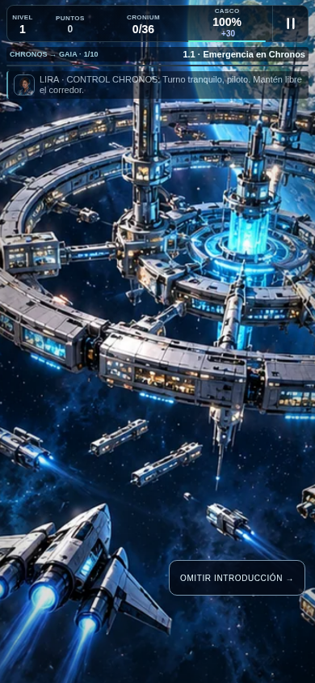
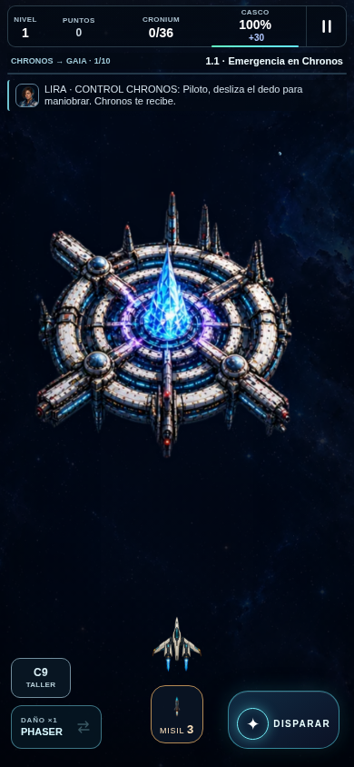
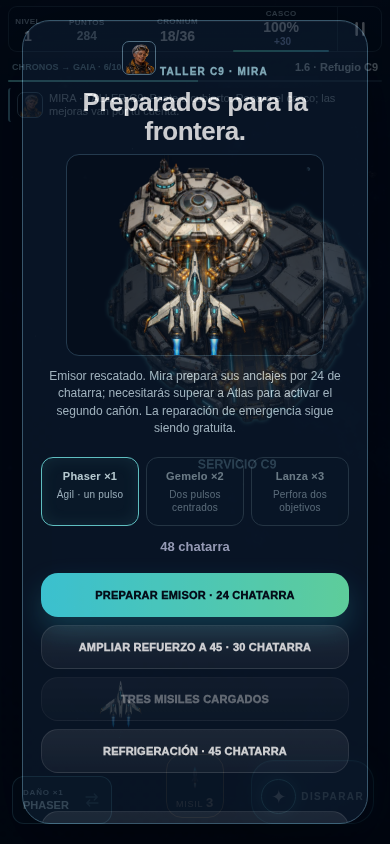
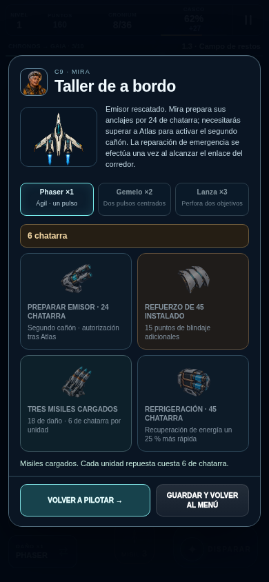
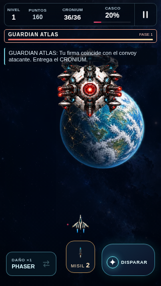
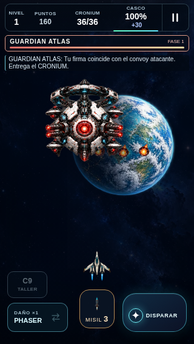
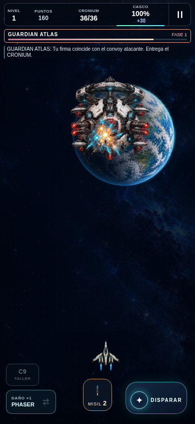

# Galería real · nivel uno dinámico

Runtime actual **da3f4b839744940fee1032a8b637d5c3266c862f**; referencia previa **99bf90b22a61cfd287393338fc55f65f3ba057a1**. Arte conceptual no sustituye capturas: todas estas imágenes proceden del juego en Chromium. Los fixtures y partidas naturales se distinguen en cada pie.

[Galería comparativa HTML](index.html) · [QA controlado12/12](visual-da3f4b8-04/results.json) · [Partida natural: estado y evidencia](natural-da3f4b8-01/results.json).

Los tres intentos fallidos del harness se conservan; sólo04 es el pase aprobado. Los intentos01/02 no aislaron peligros durante el avance instrumentado y03 no actualizó el estado de audio del frame antes de detenerlo. Se corrigió la fixture; el paquete no cambió.

## Apertura

Antes: partida natural99, introducción ilustrada. Después: escena controlada da3, Chronos del renderer jugable desde el inicio.

| Antes | Después |
| --- | --- |
|  |  |

## Taller C9

Antes: parada orbital natural99. Después: tallerHUD controlado da3 con saldo/estado declarados; los cuatro diseños están integrados, no representan dinero ganado.

| Antes | Después |
| --- | --- |
|  |  |

## Atlas y HUD en320×568

Ambas son escenas controladas del ejecutable. Se conserva el artev2; cambian movimiento, contraste y presentación. No son frames idénticos de un mismo encuentro.

| Antes | Después |
| --- | --- |
|  |  |

## Explosión del misil

Después: captura controlada del misil físico,18de daño y poses de explosión. La captura previa sólo se incluye si existe exactamente la ruta documentada.

| Antes | Después |
| --- | --- |
|  |  |

El movimiento procedural y el desarrollo temporal de la explosión se comprueban mediante series y capturas del [QA controlado](visual-da3f4b8-04/results.json); una imagen fija no acredita por sí sola una animación. La partida natural pasó4/4 (548.090ms); actualización/offline7/7. [Informe final, métricas y publicación privada22](../../LEVEL_ONE_DYNAMIC_2026-10-18.md). [Abrir el juego](https://neon-catcher-pruebas.chictide18.chatgpt.site).
