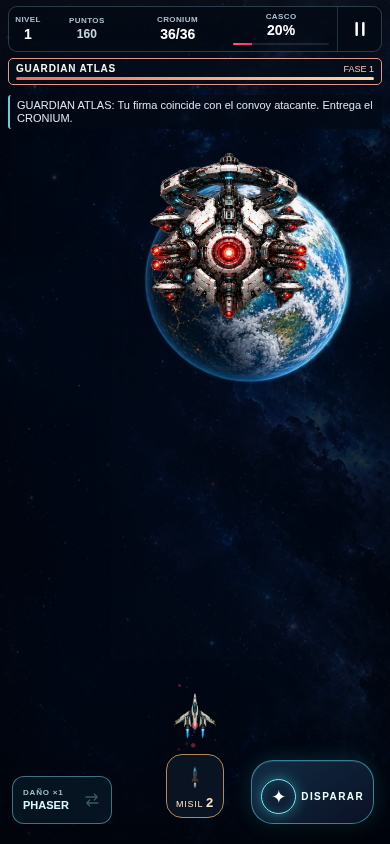
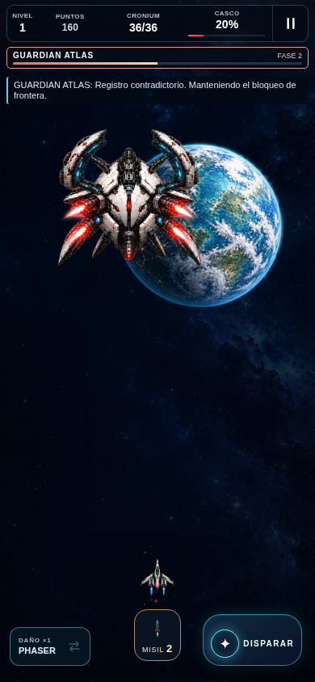
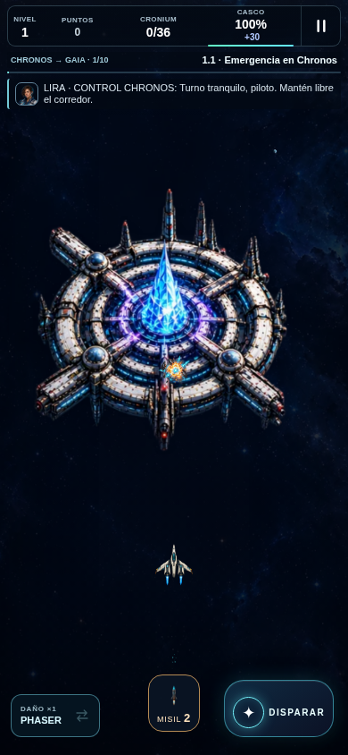
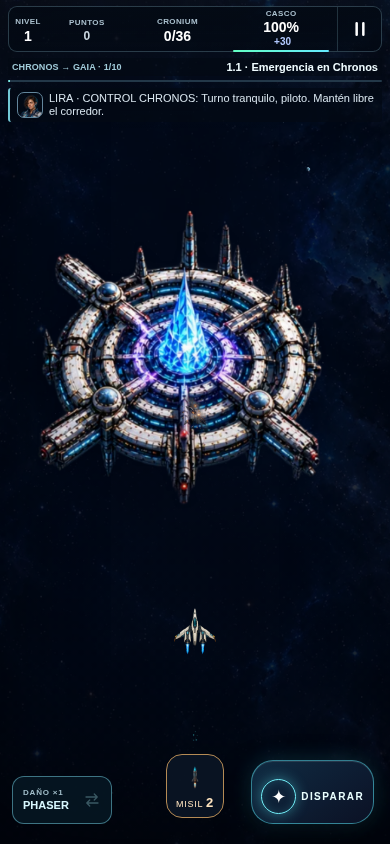
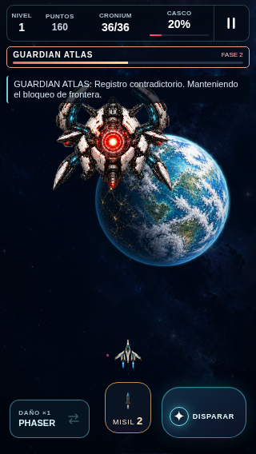
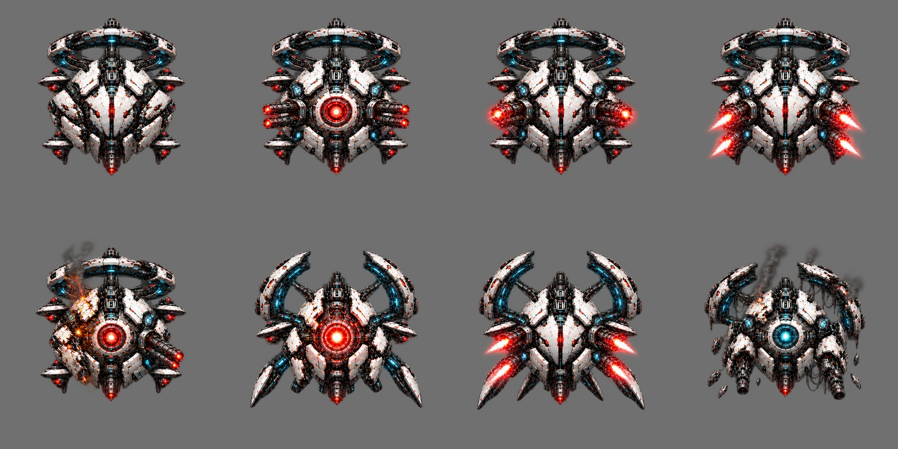
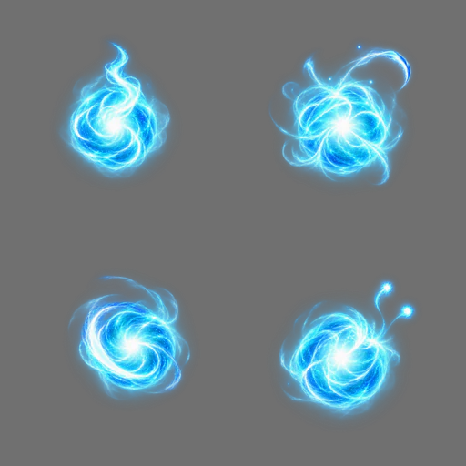

# Galería — pulido especializado ·18/10/2026

Runtime `99bf90b22a61cfd287393338fc55f65f3ba057a1`. Todas las imágenes de juego son capturas reales de Chromium con fixtures declarados. Los recursos aislados se identifican como atlas. No equivalen a aceptación artística ni Safari físico.

## Atlas: núcleo expuesto

Capturas auténticas de escenas controladas, 390×844. Antes f634a46; después99bf90b. Varían posición/instante: no es diff píxel a píxel ni prueba de balance.

Antes:

Después:

## Atlas: fase2 sin recortes

Escena controlada, coraza cerrada en ataque y extremos completos; contraste sobre Gaia pendiente de revisión.

Después:

## Nave: propulsión Bastion

Render real con bankfixture. Chorros compuestos con proporción original y anclajes; tamaño40% conservado.

Después:

## CRONIUM: energía ilustrada

Captura real con recurso insertado para revisar su contorno; no es recogida natural.

Después:

## Misil: impacto propio

Estado ilustrado reproducido por el render real, fixture declarado. No genera daño adicional.

## Pantalla pequeña

320×568. Revisión técnica aprobada; separación de transmisión y contraste pendientes.

Después:

## Recursos aislados y transparencia

Composición de atlas: **no es captura del juego**.

[Pruebas instrumentadas y hashes](game-02/results.json) · [Actualización/offline](offline-04/results.json) · [HTTP privado16/16](site-http/results.json)
