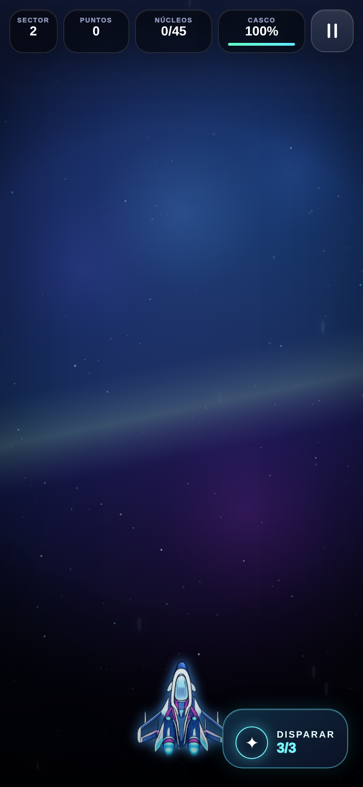
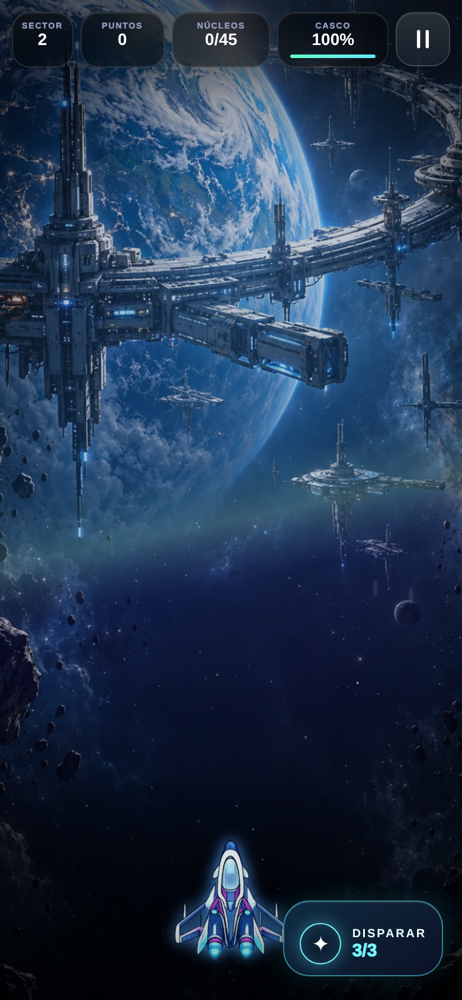
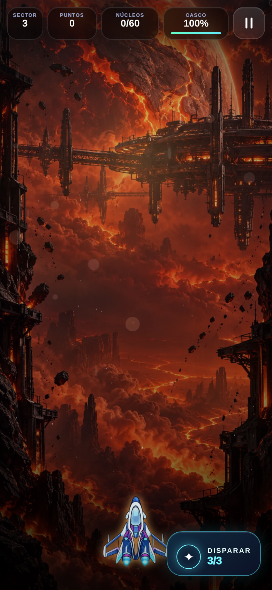
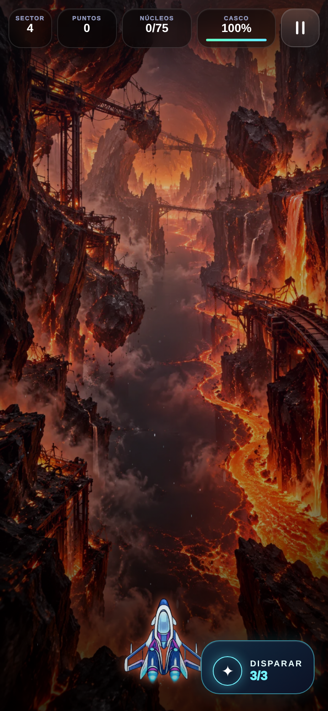
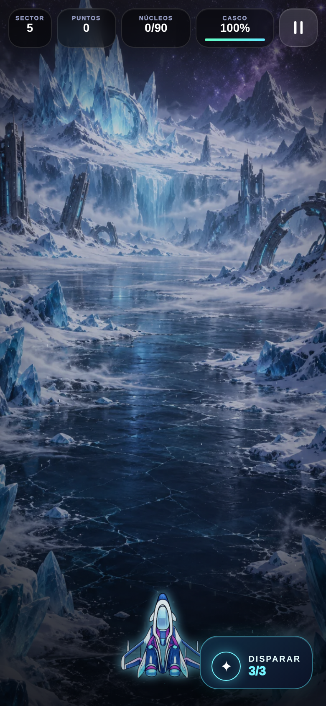
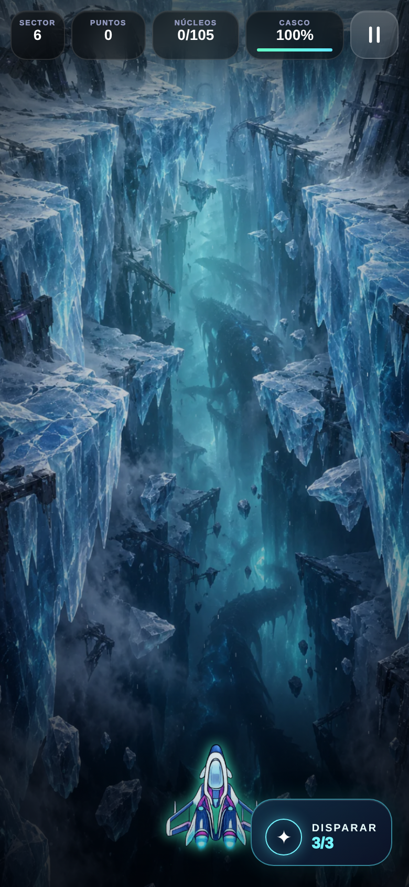
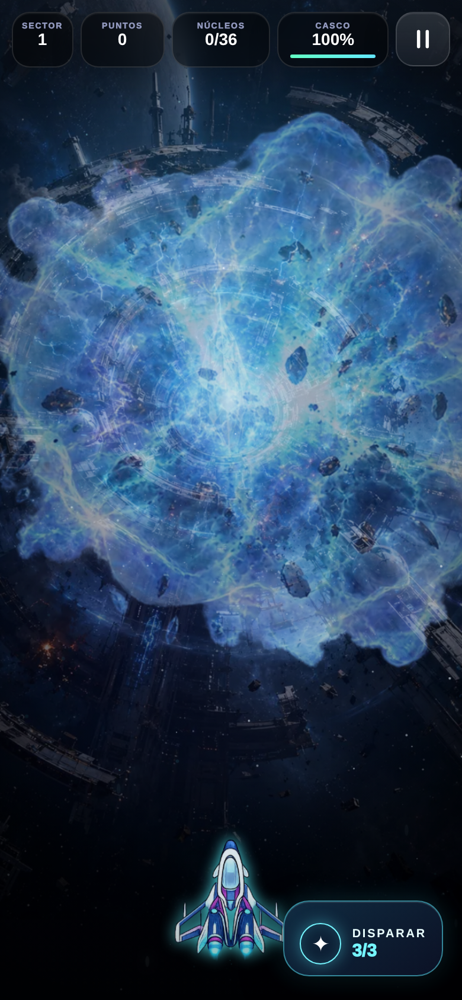

# Galería verificable · campaña clásica

Capturas **del ejecutable real** en Chromium 390×844, con la compilación local experimental. La galería inicial se obtuvo del árbol de trabajo de 2026-10-16 (`build-info.json` marcó `dirty:true`); no corresponde a la URL temporal de Netlify publicada antes del rediseño. Se usó el selector real de niveles y se inició cada partida. Registro de la primera pasada: [results.json](evidence/gallery-01/results.json), 10/10 capturas. La recaptura de Gaia Nova tras su integración: [results.json](evidence/gallery-02/results.json), 1/1. Los cuatro fotogramas de la onda se muestran con tiempo controlado en el Canvas real; el evento natural de 31 s queda pendiente de QA física.

| Nivel | Nombre y mundo | Captura del juego | Assets y animaciones visibles | Estado de integración |
| --- | --- | --- | --- | --- |
| 1 | La Onda de Choque · Chronos/Gaia Nova | [Escenario](evidence/gallery-01/level-01-game.png) · [Fase 1](evidence/gallery-01/level-01-shockwave-frame-0.png) · [Fase 2](evidence/gallery-01/level-01-shockwave-frame-1.png) · [Fase 3](evidence/gallery-01/level-01-shockwave-frame-2.png) · [Fase 4](evidence/gallery-01/level-01-shockwave-frame-3.png) | Fondo Chronos anterior + atlas CRONIUM nuevo, cuatro poses no idénticas, nave existente | Atlas integrado; escenario multicapa y enemigos propios pendientes |
| 2 | Perímetro Atlas · Gaia Nova | [Escenario nuevo](evidence/gallery-02/level-02-game.png) | Planeta y estaciones Atlas ilustrados, deriva suave, nave existente | Fondo integrado; capas separadas y CH-01/02/03 clásicos pendientes |
| 3 | Descenso Ígneo · Vulkar | [Escenario nuevo](evidence/gallery-03/level-03-game.png) | Planeta fracturado, refinería orbital, ceniza y estructuras laterales ilustradas; deriva suave | Fondo integrado; Lava Core/Plasma Mine y capas separadas pendientes |
| 4 | Rastro de la Serpiente · Vulkar | [Escenario nuevo](evidence/gallery-04/level-04-game.png) | Túnel magmático y maquinaria destruida ilustrados; deriva suave | Fondo integrado; Magma Serpent articulada y capas separadas pendientes |
| 5 | Blanco Absoluto · Cryon | [Escenario nuevo](evidence/gallery-05/level-05-game.png) | Planicie glaciar, cristales y ruinas ilustrados; deriva suave | Fondo integrado; Frost Crystal/Ice Drone y capas separadas pendientes |
| 6 | Fractura Leviatán · Cryon | [Escenario nuevo](evidence/gallery-06/level-06-game.png) | Grieta monumental, ruinas heladas y sombra ambiental ilustradas | Fondo integrado; Cryo Mine/Leviathan jugables y capas separadas pendientes |
| 7 | Ecos Imposibles · Aether | [Estado inicial](evidence/gallery-01/level-07-game.png) | Efectos procedurales; ruinas ausentes | Arte propio pendiente |
| 8 | Umbral Fantasma · Aether | [Estado inicial](evidence/gallery-01/level-08-game.png) | Energía procedural; portales/Phantom ausentes | Arte propio pendiente |
| 9 | Cementerio Gravitatorio · Titan Omega | [Estado inicial](evidence/gallery-01/level-09-game.png) | Planeta simple y geometría; cementerio ausente | Arte propio pendiente |
| 10 | Colapso Cronos · Chronos | [Estado inicial](evidence/gallery-01/level-10-game.png) | Aros procedurales; reactor final ausente | Arte propio pendiente |

## Comparación antes/después validada

**Nivel 2, Perímetro Atlas.** [Antes: gradiente casi vacío](evidence/gallery-01/level-02-game.png) → [Después: Gaia Nova y plataforma orbital integradas](evidence/gallery-02/level-02-game.png). Ambas son capturas del juego en la misma resolución y pantalla; los controles permanecen visibles. El fondo nuevo mejora la identidad del escenario, pero la animación de drones y las capas individuales no están finalizadas.

**Nivel 3, Descenso Ígneo.** [Antes: cinturón procedural](evidence/gallery-01/level-03-game.png) → [Después: Vulkar y refinería orbital](evidence/gallery-03/level-03-game.png). Son capturas del juego en Chromium; el fondo sigue en revisión porque faltan enemigos y profundidad multicapa.

**Nivel 4, Rastro de la Serpiente.** [Antes: trazos procedurales](evidence/gallery-01/level-04-game.png) → [Después: túnel magmático](evidence/gallery-04/level-04-game.png). El escenario es una captura real del ejecutable; la serpiente segmentada aún no existe en el combate.

**Nivel 5, Blanco Absoluto.** [Antes: velos procedurales](evidence/gallery-01/level-05-game.png) → [Después: planicie de Cryon](evidence/gallery-05/level-05-game.png). La captura procede del ejecutable; sus enemigos y elementos de hielo aún requieren arte animado.

**Nivel 6, Fractura Leviatán.** [Antes: campo procedural](evidence/gallery-01/level-06-game.png) → [Después: grieta glacial](evidence/gallery-06/level-06-game.png). La sombra es parte de la ilustración ambiental; todavía no hay jefe jugable.

## Onda de choque real en Canvas

La imagen siguiente es una captura controlada de la **fase 3** del atlas dentro de la partida del nivel 1, no concept art. Se forzó solo el instante del evento para congelar la imagen; la progresión y el renderizador son los del juego.

