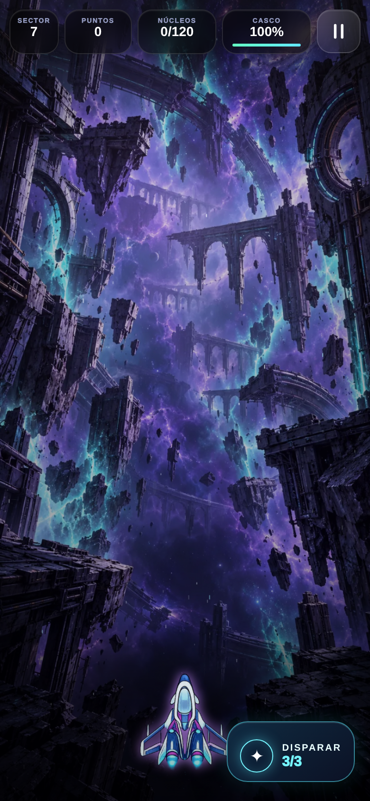
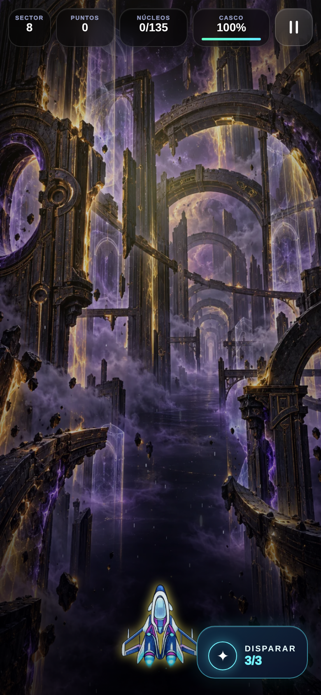
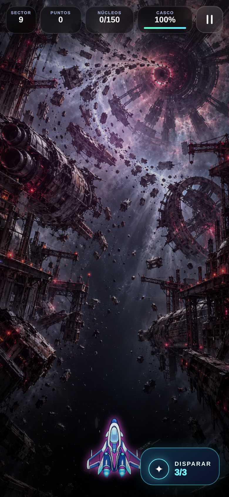
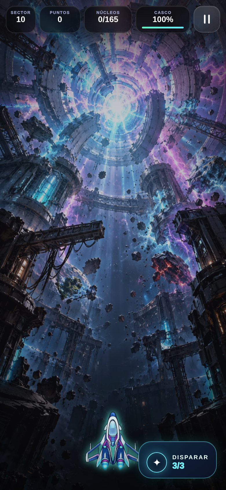

> Cierre vigente18/10/2026: [Forja y remates del nivel1](../production-reports/FORJA_LEVEL_ONE_REMATES_2026-10-18.md). Nivel1 comprende1.1–1.10yAtlas; siete remates técnicos comprobados, arte/balance humano/iPhone pendientes. El contenido siguiente conserva su valor histórico y no certifica el runtime actual.

> Cierre actual: [LEVEL_ONE_DYNAMIC,18/10/2026](../production-reports/LEVEL_ONE_DYNAMIC_2026-10-18.md). El primer territorio y sus diez tramos están técnicamente verificados y en revisión humana/artística/física; no son diez mundos terminados. Este documento conserva evidencias históricas; seguimiento único en `docs/production-tasks.json`.

> **Referencia vigente18/10/2026:** [CapítuloChronos–Gaia, Site20, pruebas y capturas](../production-reports/CHAPTER_ONE_LIVING_JOURNEY_2026-10-18.md). Este documento conserva historial. El primer nivel está integrado y en revisión; no se certifican los diez territorios ni dispositivo físico. Registro único: `docs/production-tasks.json`.

> **Cierre posterior vigente ·18/10/2026:** [MAIN_SALVAGE_COMBAT](../production-reports/MAIN_SALVAGE_COMBAT_2026-10-18.md). Site19/runtime49e4e59 y643 casos finales; ver adenda de cometasv2. El contenido siguiente es histórico. Se actualizaron el viaje clásico/combate/arte y el Site privado; no se certifican diez mundos completos por este incremento.

## Continuación vigente ·18/10/2026

[Cierre Chronos–Gaia](../production-reports/CHRONOS_PURSUIT_GAIA_2026-10-18.md): versión privada16/paquete d39ed44, CI39105045562success. Diez etapas del primer territorio con cruces/persecución; Gaia multicapa y CH-02 de16poses, ciclo completo natural4/4en332, arte/IAidénticos en d39, que corrige el refresco de puntos. Intento06actual por timeout conservado; no se presenta como otro kill. Arte/humanos/iPhone y resto deGaia pendientes; MotorV1apagado. Registro único actualizado; cifras/capturas siguientes son históricas.

<!-- score-read-guard-current -->
## DIAGNÓSTICO · refuerzo final de guardados, 17/10/2026

La revisión posterior a la versión 13 reprodujo pérdida de récord 9000→100 al denegar su lectura durante la migración. Se corrigió esa ruta y la escritura después de derrota, preservando raw inválido y claves existentes.

## INFORME DE PRODUCCIÓN · versión 14 privada

[Informe vigente, paquete, capturas y pruebas](../production-reports/SCORE_READ_GUARD_2026-10-17.md). Código limpio **f39082f**, Actions [39074965794](https://github.com/adonay1994sm-gif/Ne-n-catcher/actions/runs/39074965794) completo/success. Certificación 11/11, contenido 297/297, preview 23/23; Chromium arranque 4/4, actualización/offline 5/5, C9 y N-7 pasan. HTTP remoto 3/3 confirma SHA/bundle. Web privada **[NEON CRONIUM](https://neon-catcher-pruebas.chictide18.chatgpt.site)**, versión 14, fuente Site 5f06e63; 147 archivos ajenos preservados. CONTINUAR VIAJE abre `/clasico-actual/`.

Se mantienen C9 ilustrada, selección de armas, Gaia encuadrada, partituras contextuales y confort del lote anterior. [Su informe y partidas naturales](../production-reports/VOYAGE_POLISH_2026-10-17.md) siguen válidos con sus SHA originales; el refuerzo sólo altera dos funciones de persistencia. Revisión artística/humana/iPhone y contenido restante pendientes. Correo de soporte aplazado por el propietario. Motor V1 apagado; no producción, main, PR #3 ni tiendas.

Las secciones siguientes conservan el historial de cada versión; esta actualización es el estado vigente.
<!-- /score-read-guard-current -->

---

<!-- voyage-polish-current -->
## DIAGNÓSTICO · continuidad y pulido Chronos–Gaia,17/10/2026

El propietario autoriza ejecutar el plan de publicación. Se conserva HEAD827c1b5 y el trabajo externo del motor. Este lote cierra mejoras concretas del clásico; no100 etapas ni diez mundos visualmente completos.

## INFORME DE PRODUCCIÓN · versión13 privada publicada

[Informe completo, capturas, pruebas y ZIP](../production-reports/VOYAGE_POLISH_2026-10-17.md). **[Abrir NEON CRONIUM](https://neon-catcher-pruebas.chictide18.chatgpt.site)** → CONTINUAR VIAJE. Paquete limpio6cf67fc; fuente del Site653e328; publicación succeeded22:01:35UTC. C9 ilustrada con cuatro estados, selección de armas, Gaia fuera del HUD, música contextual, confort y journal de finalización. Partida natural Chronos4/4, Atlas con Gemelo4/4 yAtlas con Pulso4/4, C9final1/1, actualización/offline5/5, N-7una sesión/seis pasos. Certificación11/11 y Actions39072721336 completo/success. Pulso se completó sobre el paquete final; primer fallo del arnés conservado.

Preservado el avance orbital remoto404b65f y147 archivos byteporbyte. El clásico actual ocupa `/clasico-actual/`; no se reemplaza el modo orbital ni se activa MotorV1. Para revisar desde una partida avanzada: NIVELES → La Onda de Choque →1.1.

Registro único314 tareas:26 DONE,72 IN_REVIEW,5 IN_PROGRESS,203 PENDING,8 BLOCKED; no es porcentaje comercial. Confort/recuperación lógica cerrados; arte/audio en revisión; humanos e iPhone pendientes. Contacto de soporte aplazado por el propietario. No producción Netlify, main, PR3, firmado o tiendas.

El contenido siguiente conserva historial y cifras de su propia compilación; no sustituye este cierre.
<!-- /voyage-polish-current -->

---

> Nombre vigente **NEON CRONIUM**,17/10/2026: [rebranding y versión11](../production-reports/REBRAND_NEON_CRONIUM_2026-10-17.md). Los informes anteriores conservan su marca/procedencia histórica.

> Cierre vigente posterior — 17/10/2026: [diez etapas de tránsito Chronos → Gaia, versión10, capturas reales y certificación](../production-reports/CHRONOS_GAIA_10_STAGES_2026-10-17.md). El contenido siguiente se conserva como historial de sus entregas; estas etapas no certifican los diez territorios visualmente completos.

> Continuidad vigente, 17/10/2026: [nave modular única, cometa y dos dedos — versión privada 9](../production-reports/SHIP_TOUCH_COMET_2026-10-17.md). Este informe y sus capturas son históricos; el lote nuevo no declara ningún nivel adicional completo ni certificación física.

> Actualización posterior,17/10/2026: [combate, escudo y Vulkar orbital](../production-reports/COMBAT_READABILITY_2026-10-17.md), versión8 publicada. El contenido siguiente se conserva como historial; cero niveles nuevos declarados visualmente completos.

> **Nueva captura real del nivel 1, 17/10/2026:** [fractura de Chronos](../production-reports/evidence/chronos-destruction/browser-event-02/natural-03-rupture.png), [seis fases y comparación antes/después](../production-reports/CHRONOS_DESTRUCTION_2026-10-17.md). Es una integración jugable, en revisión artística; no un nivel cerrado. Las imágenes anteriores siguen siendo historial de los otros escenarios.

---

Actualización17/10/2026: la [galería de partida natural](../production-reports/UNIFIED_FLIGHT_2026-10-17.md#g-galería-real-del-ejecutable) añade ataque, Chronos roto/alejándose, tránsito, taller y disparo gemelo en Gaia. Son capturas reales del primer recorrido, no diez escenarios nuevos. La galería previa queda como historial.

---

> Galería histórica de la campaña clásica. Capturas del viaje nuevo y cierre vigente: [P0/P1 Chronos-Gaia](../production-reports/P0_P1_CHRONOS_GAIA_2026-10-17.md); visión rectora: [PRODUCT_VISION.md](../PRODUCT_VISION.md).

# Galería verificable · campaña clásica

**Actualización inmersiva 17/10/2026:** el encuentro controlado CH-01 del nivel 2 tiene [ataque](../immersive-rebirth/evidence/classic-scout-06/gaia-scout-attack.png), [disparo](../immersive-rebirth/evidence/classic-scout-06/gaia-scout-fired.png) y [daño](../immersive-rebirth/evidence/classic-scout-06/gaia-scout-hurt.png) capturados en el Canvas real. El informe [Immersive Rebirth](../immersive-rebirth/IMMERSIVE_LATEST_REPORT.md) distingue esta prueba de una partida natural completa. El nivel 2 permanece IN_REVIEW.

Capturas **del ejecutable real** en Chromium 390×844, con la compilación local experimental. La galería inicial se obtuvo del árbol de trabajo de 2026-10-16 (`build-info.json` marcó `dirty:true`); no corresponde a la URL temporal de Netlify publicada antes del rediseño. Se usó el selector real de niveles y se inició cada partida. Registro de la primera pasada: [results.json](evidence/gallery-01/results.json), 10/10 capturas. La recaptura de Gaia Nova tras su integración: [results.json](evidence/gallery-02/results.json), 1/1. Los cuatro fotogramas de la onda se muestran con tiempo controlado en el Canvas real; el evento natural de 31 s queda pendiente de QA física.

| Nivel | Nombre y mundo | Captura del juego | Assets y animaciones visibles | Estado de integración |
| --- | --- | --- | --- | --- |
| 1 | La Onda de Choque · Chronos/Gaia Nova | [Escenario](evidence/gallery-01/level-01-game.png) · [Fase 1](evidence/gallery-01/level-01-shockwave-frame-0.png) · [Fase 2](evidence/gallery-01/level-01-shockwave-frame-1.png) · [Fase 3](evidence/gallery-01/level-01-shockwave-frame-2.png) · [Fase 4](evidence/gallery-01/level-01-shockwave-frame-3.png) | Fondo Chronos anterior + atlas CRONIUM nuevo, cuatro poses no idénticas, nave existente | Atlas integrado; escenario multicapa y enemigos propios pendientes |
| 2 | Perímetro Atlas · Gaia Nova | [Escenario nuevo](evidence/gallery-02/level-02-game.png) · [CH-01 en combate](../immersive-rebirth/evidence/classic-scout-06/gaia-scout-attack.png) | Planeta y estaciones Atlas ilustrados, atlas CH-01 con ataque/daño, nave existente | CH-01 integrado y probado en Chromium controlado; capas separadas, CH-02/03, balance/iPhone pendientes |
| 3 | Descenso Ígneo · Vulkar | [Escenario nuevo](evidence/gallery-03/level-03-game.png) | Planeta fracturado, refinería orbital, ceniza y estructuras laterales ilustradas; deriva suave | Fondo integrado; Lava Core/Plasma Mine y capas separadas pendientes |
| 4 | Rastro de la Serpiente · Vulkar | [Escenario nuevo](evidence/gallery-04/level-04-game.png) | Túnel magmático y maquinaria destruida ilustrados; deriva suave | Fondo integrado; Magma Serpent articulada y capas separadas pendientes |
| 5 | Blanco Absoluto · Cryon | [Escenario nuevo](evidence/gallery-05/level-05-game.png) | Planicie glaciar, cristales y ruinas ilustrados; deriva suave | Fondo integrado; Frost Crystal/Ice Drone y capas separadas pendientes |
| 6 | Fractura Leviatán · Cryon | [Escenario nuevo](evidence/gallery-06/level-06-game.png) | Grieta monumental, ruinas heladas y sombra ambiental ilustradas | Fondo integrado; Cryo Mine/Leviathan jugables y capas separadas pendientes |
| 7 | Ecos Imposibles · Aether | [Escenario nuevo](evidence/gallery-07-08/level-07-game.png) | Cementerio temporal y ruinas flotantes ilustrados | Fondo integrado; Time Echo/Rift Orb y capas separadas pendientes |
| 8 | Umbral Fantasma · Aether | [Escenario nuevo](evidence/gallery-07-08/level-08-game.png) | Portales y arquitectura translúcida ilustrados | Fondo integrado; Chrono Phantom y capas separadas pendientes |
| 9 | Cementerio Gravitatorio · Titan Omega | [Escenario nuevo](evidence/gallery-09-10/level-09-game.png) | Cementerio orbital y núcleo gravitatorio ilustrados | Fondo integrado; enemigos y capas separadas pendientes |
| 10 | Colapso Cronos · Chronos | [Escenario nuevo](evidence/gallery-10-qa02/level-10-game.png) | Reactor inestable e instalación destruida ilustrados | Fondo integrado; secuencia final, animación del reactor y capas separadas pendientes |

## Comparación antes/después validada

**Nivel 2, Perímetro Atlas.** [Antes: gradiente casi vacío](evidence/gallery-01/level-02-game.png) → [Después: Gaia Nova y plataforma orbital integradas](evidence/gallery-02/level-02-game.png). Ambas son capturas del juego en la misma resolución y pantalla; los controles permanecen visibles. El fondo nuevo mejora la identidad del escenario, pero la animación de drones y las capas individuales no están finalizadas.

**Nivel 3, Descenso Ígneo.** [Antes: cinturón procedural](evidence/gallery-01/level-03-game.png) → [Después: Vulkar y refinería orbital](evidence/gallery-03/level-03-game.png). Son capturas del juego en Chromium; el fondo sigue en revisión porque faltan enemigos y profundidad multicapa.

**Nivel 4, Rastro de la Serpiente.** [Antes: trazos procedurales](evidence/gallery-01/level-04-game.png) → [Después: túnel magmático](evidence/gallery-04/level-04-game.png). El escenario es una captura real del ejecutable; la serpiente segmentada aún no existe en el combate.

**Nivel 5, Blanco Absoluto.** [Antes: velos procedurales](evidence/gallery-01/level-05-game.png) → [Después: planicie de Cryon](evidence/gallery-05/level-05-game.png). La captura procede del ejecutable; sus enemigos y elementos de hielo aún requieren arte animado.

**Nivel 6, Fractura Leviatán.** [Antes: campo procedural](evidence/gallery-01/level-06-game.png) → [Después: grieta glacial](evidence/gallery-06/level-06-game.png). La sombra es parte de la ilustración ambiental; todavía no hay jefe jugable.

**Nivel 7, Ecos Imposibles.** [Antes: rectángulos de eco](evidence/gallery-01/level-07-game.png) → [Después: cementerio temporal](evidence/gallery-07-08/level-07-game.png). Persisten enemigos genéricos.

**Nivel 8, Umbral Fantasma.** [Antes: trazos de energía](evidence/gallery-01/level-08-game.png) → [Después: complejo de portales](evidence/gallery-07-08/level-08-game.png). El Chrono Phantom aún no está representado como entidad animada.

**Nivel 9, Cementerio Gravitatorio.** [Antes: planeta procedural](evidence/gallery-01/level-09-game.png) → [Después: cementerio orbital de Titan Omega](evidence/gallery-09-10/level-09-game.png). Los tres enemigos nombrados carecen todavía de sprites propios.

**Nivel 10, Colapso Cronos.** [Antes: aros procedurales](evidence/gallery-01/level-10-game.png) → [Después: reactor CRONIUM destruido](evidence/gallery-10-qa02/level-10-game.png). La estabilización/colapso animados siguen pendientes. Varias capturas posteriores de Chromium omiten intermitentemente glifos del botón y del HUD pese a que el DOM conserva `DISPARAR`, `3/3` y la geometría del control; la causa del repintado queda en revisión. La captura enlazada muestra una pasada legible, no certificación de ausencia del defecto.

## Onda de choque real en Canvas

La imagen siguiente es una captura controlada de la **fase 3** del atlas dentro de la partida del nivel 1, no concept art. Se forzó solo el instante del evento para congelar la imagen; la progresión y el renderizador son los del juego.

